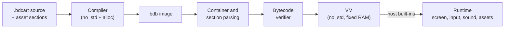

# Bidule 01 — Bytecode and cart image format

Nov 2, 2026 · @Pierre-Clément

Status: **Proposed**, format version 2. This is the byte-for-byte format that the technical specification requires (Runtime, VM and bytecode). It is implemented by the Rust crates in `crates/`; `bidule-bytecode` is its single source of truth, and the opcode and built-in tables below are generated from it. Conventions are those of the technical specification: RFC 2119 keywords, **Fixed** / **Proposed** / **TBD** tags.

All multi-byte values are little-endian. Offsets are in bytes unless stated.

## Overview

A `.bdb` image is a container of sections. The compiler writes it, and devices store, exchange and run it. Loading a cart parses the container and every section with fixed size limits, then verifies all code, before any instruction runs (SEC-2, SEC-6).

## Container

| Offset | Size | Field |
| --- | --- | --- |
| 0 | 4 | Magic `42 44 42 1A` (`BDB` and Ctrl-Z) |
| 4 | 2 | Format version: 2 |
| 6 | 2 | Flags: 0 (reserved) |
| 8 | 2 | Compiler version: major << 8 \| minor |
| 10 | 2 | Section count |
| 12 | 4 | Total size of the file |
| 16 | 4 | CRC-32 (IEEE, as zlib) of the whole file, computed with this field as zero |
| 20 | 4 | Reserved: 0 |
| 24 | 12 × n | Section directory: kind (u16), flags (u16, 0), offset (u32), length (u32) |

One canonical encoding per cart, so hashes and signatures are stable:

- Sections appear in increasing kind order, each kind at most once.
- The first section starts at the directory's end rounded up to 4; each next section starts at the previous one's end rounded up to 4. Padding bytes are 0, and the file ends after the last section's padding.
- Any other layout, a wrong length or a wrong checksum rejects the cart.
- Proposed: at most 4 MB per cart until the flash size is chosen.

**Section kinds**

| Kind | Section | Present | Content |
| --- | --- | --- | --- |
| `0x01` | META | Written always | Metadata: count (u8), then per pair key length (u8), key, value length (u8), value. Keys are the source's `@title`, `@author`, `@version`, `@desc`, `@id`, `@license`, `@spoilers` |
| `0x02` | PROGRAM | Required | Globals, arrays, functions and handlers (below) |
| `0x03` | CODE | Required | Bytecode of every function, back to back |
| `0x04` | ROM | If any table | Constant tables (below) |
| `0x05` | TEXT | If any template | Text templates for interpolated strings (below) |
| `0x06` | DEBUG | No | Names and line table (below) |
| `0x07` | SOURCE | Written always | The cart's source, uncompressed. Proposed: loaders reject carts without it |
| `0x10` | SPRITES | No | Asset section, common container (technical specification) |
| `0x11` | MAPS | No | Asset section |
| `0x12` | SOUNDS | No | Asset section |
| `0x13` | MUSIC | No | Asset section, layout TBD |
| `0x14` | PALETTE | No | Asset section |

TBD: identity and lineage (author key, signature, parent hash, threat model) get their own section kind once signing is specified. The asset container's kind byte is the low byte of the section kind (`0x10`–`0x14`).

## PROGRAM section

| Part | Size | Content |
| --- | --- | --- |
| Header | 16 | Global count G (u16, ≤ 256), array count A (u16, ≤ 255), function count F (u16, ≤ 1,024), audio-variable count V (u16, ≤ 64), then the function index of `init`, `update`, `draw`, `audio` (u16 each, `0xFFFF` = absent) |
| Globals | 4 × G | Initial value of each global int (i32) |
| Audio variables | 4 × V | Initial value of each `audio var` |
| Arrays | 8 × A | Pool offset (u16), length (u16), row length (u16, 0 = 1D), initializer table (u16, ROM table id, `0xFFFF` = none) |
| Functions | 8 × F | Code offset (u32), parameter slots (u8), local slots (u8, ≥ parameters, ≤ 64), maximum stack depth (u8, ≤ 254), reserved (u8, 0) |

- Arrays lie inside the 4,096-int pool; a 2D array's length is a whole number of rows. An initializer table may be shorter than its array; the rest starts at 0.
- Functions cover the code section exactly: the first starts at 0, each next one where the previous ends, the last ends at the end of the code. Handlers take at most 0 (`init`), 2 (`update`, `draw`) or 1 (`audio`) parameters.
- The maximum stack depth MUST equal the depth the verifier computes, so equal carts have equal bytes.

## Instructions

An instruction is an opcode byte followed by its operands. Values on the stack are 32-bit; the VM does not know which are int and which are 16.16 fix (the compiler does). Jump targets are absolute code offsets inside the current function.

| Code | Name | Operands | Pops → pushes | Effect |
| --- | --- | --- | --- | --- |
| `0x00` | `NOP` | — | 0 → 0 | Does nothing. |
| `0x01` | `PUSH_INT` | i32 | 0 → 1 | Pushes a 32-bit constant. |
| `0x02` | `PUSH_I8` | i8 | 0 → 1 | Pushes a sign-extended 8-bit constant. |
| `0x03` | `POP` | — | 1 → 0 | Discards the top value. |
| `0x04` | `DUP` | — | 1 → 2 | Duplicates the top value. |
| `0x05` | `GLOBAL_LOAD` | u8 | 0 → 1 | Pushes global int `n`. |
| `0x06` | `GLOBAL_STORE` | u8 | 1 → 0 | Pops into global int `n`. |
| `0x07` | `LOCAL_LOAD` | u8 | 0 → 1 | Pushes local `n` of the current frame. |
| `0x08` | `LOCAL_STORE` | u8 | 1 → 0 | Pops into local `n` of the current frame. |
| `0x09` | `AUDIO_LOAD` | u8 | 0 → 1 | Pushes audio-local `n` (audio handler only). |
| `0x0A` | `AUDIO_STORE` | u8 | 1 → 0 | Pops into audio-local `n` (audio handler only). |
| `0x0B` | `DUP2` | — | 2 → 4 | Duplicates the top two values: a b -> a b a b. |
| `0x10` | `ADD` | — | 2 → 1 | a + b, wrapping. |
| `0x11` | `SUB` | — | 2 → 1 | a - b, wrapping. |
| `0x12` | `MUL` | — | 2 → 1 | a * b, wrapping (int). |
| `0x13` | `DIV` | — | 2 → 1 | a / b truncated toward zero; b = 0 is a fault (result 0). |
| `0x14` | `MOD` | — | 2 → 1 | a % b with the sign of a; b = 0 is a fault (result 0). Also used for fix. |
| `0x15` | `NEG` | — | 1 → 1 | -a, wrapping. |
| `0x16` | `FMUL` | — | 2 → 1 | (a * b) >> 16 with a 64-bit intermediate. |
| `0x17` | `FDIV` | — | 2 → 1 | (a << 16) / b with a 64-bit intermediate, truncated; b = 0 is a fault. |
| `0x20` | `BAND` | — | 2 → 1 | a & b. |
| `0x21` | `BOR` | — | 2 → 1 | a \| b. |
| `0x22` | `BXOR` | — | 2 → 1 | a ^ b. |
| `0x23` | `SHL` | — | 2 → 1 | a << (b & 31). |
| `0x24` | `SHR` | — | 2 → 1 | a >> (b & 31), arithmetic. |
| `0x25` | `BNOT` | — | 1 → 1 | ~a. |
| `0x30` | `EQ` | — | 2 → 1 | 1 if a == b else 0. |
| `0x31` | `NE` | — | 2 → 1 | 1 if a != b else 0. |
| `0x32` | `LT` | — | 2 → 1 | 1 if a < b else 0 (signed). |
| `0x33` | `LE` | — | 2 → 1 | 1 if a <= b else 0. |
| `0x34` | `GT` | — | 2 → 1 | 1 if a > b else 0. |
| `0x35` | `GE` | — | 2 → 1 | 1 if a >= b else 0. |
| `0x36` | `NOT` | — | 1 → 1 | 1 if a == 0 else 0. |
| `0x37` | `BOOL` | — | 1 → 1 | 1 if a != 0 else 0. |
| `0x40` | `JMP` | u32 target | 0 → 0 | Jumps to an absolute code offset. |
| `0x41` | `JZ` | u32 target | 1 → 0 | Pops; jumps if zero. |
| `0x42` | `JNZ` | u32 target | 1 → 0 | Pops; jumps if not zero. |
| `0x50` | `CALL_FN` | u16 | params → 1 | Calls user function `n`: its parameters are popped into locals 0..argc-1 of a new frame. |
| `0x51` | `CALL` | u8 id, u8 argc | argc → 1 | Calls built-in `id` with `argc` arguments; always pushes one result. |
| `0x52` | `RET` | — | 1 → 0 | Pops the return value and leaves the frame. |
| `0x60` | `ARR_GET` | u8 | 1 → 1 | i -> pool array `n`[i]. |
| `0x61` | `ARR_SET` | u8 | 2 → 0 | i v -> pool array `n`[i] = v. |
| `0x62` | `ARR_GET2` | u8 | 2 → 1 | r c -> pool array `n`[r][c], each index checked. |
| `0x63` | `ARR_SET2` | u8 | 3 → 0 | r c v -> pool array `n`[r][c] = v. |
| `0x64` | `PUSH_ARR` | u8 | 0 → 1 | Pushes a handle to pool array `n`. |
| `0x65` | `ROW` | — | 2 → 1 | h r -> handle to row r of 2D array h. |
| `0x66` | `CHK` | u16 | 1 → 1 | Debug mode: faults if the top value is outside 0..n-1. Release: no effect. |
| `0x74` | `ARR_GET_DYN` | — | 2 → 1 | h i -> element i of the array behind handle h. |
| `0x75` | `ARR_SET_DYN` | — | 3 → 0 | h i v -> element i of h = v (pool handles only). |
| `0x76` | `ARR_LEN_DYN` | — | 1 → 1 | h -> element count of h. |
| `0x78` | `ROM_GET` | u16 | 1 → 1 | i -> constant table `n`[i]. |
| `0x79` | `PUSH_ROM` | u16 | 0 → 1 | Pushes a read-only handle to constant table `n`. |
| `0x7A` | `ROM_GET2` | u16 | 2 → 1 | r c -> constant table `n`[r][c], each index checked. |
| `0x7B` | `TEXT` | u16 | argc of template → 1 | Pops the arguments of text template `n` and pushes a template handle. |

Integer and fix conversions have no opcode: the compiler emits `<< 16` to promote an int, `>> 16` for `int(x)`, `+ 32768` then `>> 16` for `round(x)` and `& 0xFFFF` for `frac(x)`.

**Calls.** `CALL_FN` pops the arguments into locals 0..argc−1 of a new frame (first argument in local 0) and zeroes the other locals. `RET` pops the return value, drops the frame, and pushes the value in the caller. A function that ends without `return` returns 0.

**Arrays.** `ARR_GET`/`ARR_SET` index pool array `n` directly; the 2D forms check row and column separately. The `_DYN` forms work through a handle (below), for array and record parameters. `ARR_LEN_DYN` gives the row count of a whole 2D array, the row length of a row, and the element count otherwise.

## Handles

Arrays passed to functions and built-ins are handles: ordinary 32-bit values, decoded and checked on every use, so a forged value can only fault.

| Bits | Field |
| --- | --- |
| 0–15 | Offset: first element (a row: row × row length; a template: base of its arguments) |
| 16–25 | Id: pool array (0–254), constant table or template (0–1,023) |
| 26–27 | Kind: 0 pool array, 1 constant table, 2 text template, 3 null |
| 28 | Row: the handle covers one row of a 2D array |
| 29–31 | 0 |

Writing through a constant-table handle is refused. A null handle reads as 0.

**Records.** Records don't exist in the bytecode (technical specification › Records). Each numeric field of a record type is a *leaf*; a record variable or record array gets one array per leaf, with consecutive ids, in field order. A leaf holding *m* numbers per record (a field array, or nested arrays) is a 2D array of row length *m*; other leaves are 1D. A record reference is two values: the handle of the record's first leaf, and the record's index. Field *k* of a reference is that handle plus `k << 16`. Constant record tables use the same layout in consecutive ROM tables.

## ROM section

| Part | Size | Content |
| --- | --- | --- |
| Header | 4 | Table count T (u16, ≤ 1,024), reserved (u16, 0) |
| Directory | 12 × T | Data offset from the section start (u32), element count (u16), row length (u16, 0 = 1D), width (u8: 1, 2 or 4), signed (u8: 0 or 1), reserved (u16, 0) |
| Data | | Elements at their width, little-endian; each table aligned to its width |

The compiler stores each table at the narrowest width and signedness that holds all its values; reads always widen to 32 bits. String literals used as values are null-terminated text tables; identical literals share one table.

## TEXT section

| Part | Size | Content |
| --- | --- | --- |
| Header | 4 | Template count (u16, ≤ 1,024), reserved (u16, 0) |
| Offsets | 4 × count | Offset of each template from the section start |
| Templates | | Argument count (u8, ≤ 16), then pieces, then `00` |

| Piece | Bytes |
| --- | --- |
| Literal | `01`, length (u8, 1–255), the characters |
| Value | `02`, type (u8: 0 int, 1 fix, 2 text handle), flags (u8: 1 zero-pad, 2 hex, 4 char, 8 decimals given), width (u8), decimals (u8, ≤ 8) |

`TEXT n` pops template *n*'s arguments onto a separate 64-value format stack and pushes a template handle. The built-in that receives the handle formats the text natively, then releases those arguments. Templates are accepted only as direct arguments of text built-ins, so nesting is last-in, first-out. Formatting follows the browser prototype exactly: fix prints with up to 4 decimals (trailing zeros dropped) or exactly the decimals asked, rounded half up; hex prints the 32-bit pattern in lowercase; formatted text is cut at 512 bytes.

## DEBUG section

Optional; carts without it run the same, and faults then show code offsets.

| Part | Content |
| --- | --- |
| Names | Count (u16) = A + F, then per name: length (u8), name. Arrays first (record leaves as `enemies.pos.x`), then functions |
| Padding | To a multiple of 4 |
| Line table | Count (u32), then per entry: code offset (u32), line (u16), column (u16), sorted by offset. An offset maps to the last entry at or before it |

## Built-ins

`CALL id argc` runs a built-in; it always pushes one result. Ids never change. The argument kinds tell the compiler how to pass values:

| Kind | Passed as |
| --- | --- |
| Int | int; a fix argument is rounded down (`>> 16`) |
| Fix | fix; an int is promoted |
| Angle | degrees as fix; an int is reduced modulo 360, then promoted |
| Same | unchanged; if any `Same` argument is fix, the others are promoted and the result is fix |
| Text | a text handle: string literal (ROM table), template, array, row or table. A number is passed as a one-value template |
| ArrW / ArrR | a writable / readable array handle |

| Id | Name | Arguments | Result | Notes |
| --- | --- | --- | --- | --- |
| 0 | `cls` | [Int] | Int |  |
| 1 | `pset` | Int, Int, Int | Int |  |
| 2 | `pget` | Int, Int | Int |  |
| 3 | `line` | Int, Int, Int, Int, Int | Int |  |
| 4 | `rect` | Int, Int, Int, Int, Int | Int |  |
| 5 | `rectfill` | Int, Int, Int, Int, Int | Int |  |
| 6 | `circ` | Int, Int, Int, Int | Int |  |
| 7 | `circfill` | Int, Int, Int, Int | Int |  |
| 8 | `spr` | Int, Int, Int | Int |  |
| 9 | `map` | Int, Int, Int, Int, Int, Int, Int | Int |  |
| 10 | `fget` | Int, Int | Int |  |
| 11 | `print` | Text, Int, Int, [Int] | Int |  |
| 12 | `textwidth` | Text | Int |  |
| 13 | `fmt` | ArrW, Text | Int |  |
| 14 | `btn` | Int | Int | 0–5 are buttons; 6–7 are reserved for X and Y and read as 0 |
| 15 | `btnp` | Int | Int | As `btn` |
| 16 | `haspointer` |  | Int |  |
| 17 | `mousex` |  | Int |  |
| 18 | `mousey` |  | Int |  |
| 19 | `mouseb` |  | Int |  |
| 20 | `setpal` | Int, Int, Int, Int | Int |  |
| 21 | `getpal` | Int, Int | Int |  |
| 22 | `palt` | Int | Int |  |
| 23 | `sin` | Angle | Fix | Also in `audio(t)` |
| 24 | `cos` | Angle | Fix | Also in `audio(t)` |
| 25 | `atan2` | Fix, Fix | Fix | Also in `audio(t)` |
| 26 | `sqrt` | Fix | Fix | Also in `audio(t)` |
| 27 | `abs` | Same | Same | Also in `audio(t)` |
| 28 | `min` | Same, Same | Same | Also in `audio(t)` |
| 29 | `max` | Same, Same | Same | Also in `audio(t)` |
| 30 | `clamp` | Same, Same, Same | Same | Also in `audio(t)` |
| 31 | `rnd` | Int | Int |  |
| 32 | `srand` | Int | Int |  |
| 33 | `copy` | ArrW, ArrR | Int |  |
| 34 | `streq` | Text, Text | Int |  |
| 35 | `arreq` | ArrR, ArrR, Int | Int |  |
| 36 | `play` | Int, [Int] | Int |  |
| 37 | `stop` | Int | Int |  |
| 38 | `stopall` |  | Int |  |
| 39 | `playing` | Int | Int |  |
| 40 | `cue` | Int | Int |  |
| 41 | `cuecount` | Int | Int | Also in `audio(t)` |
| 42 | `pickcart` | Text | Int | May open a system dialog |
| 43 | `opensection` | Int, Text | Int |  |
| 44 | `cartname` | Int, ArrW | Int |  |
| 45 | `drawasset` | Int, Int, Int, Int | Int |  |
| 46 | `status` | Text | Int |  |
| 47 | `readasset` | Int, ArrW, Int | Int |  |
| 48 | `writeasset` | Int, ArrR, Int | Int |  |
| 49 | `assetcount` | Int | Int |  |
| 50 | `assetname` | Int, Int, ArrW | Int |  |
| 51 | `setassetname` | Int, Int, Text | Int |  |
| 52 | `savecart` | Int | Int | May open a system dialog |
| 53 | `__mapcell` | Int, Int, Int | Int | Internal: `Maps.NAME[y][x]` |
| 54 | `menuitem` | Int, Text | Int | Reserved: cart entries in the system menu. Not callable in Bidule 01 |
| 55 | `menuchosen` |  | Int | Reserved: the entry chosen since the last call, or −1. Not callable in Bidule 01 |
| 56 | `cartcount` |  | Int |  |
| 57 | `cartinfo` | Int, ArrW | Int |  |
| 58 | `opencart` | Int, Text | Int |  |
| 59 | `requestwrite` | Int | Int | May open a system dialog |

Reserved ids exist so the numbering never moves. The compiler reports their names as reserved and the verifier rejects them until a later version defines them.

Math, `rnd`, `srand`, `copy`, `streq`, `arreq`, `fmt` and `textwidth` run inside the VM, identically on every target. The rest go to the platform runtime. Arguments in brackets are optional.

- `sin`, `cos` reduce any angle and use a 91-entry table of `round(sin(d°) × 65536)` with linear interpolation; results are exact at multiples of 90° and symmetric. `atan2` uses a 257-entry table of `atan(i/256)` with octant folding; `sqrt` is the exact floor of the root.
- `rnd(n)` is xorshift32 followed by `(x × n) >> 32`; `srand(0)` and a zero load seed use `0x9E3779B9`. The runtime seeds the generator at cart load.
- A source `sprite NAME = tile, w, h` is the int `0x40000000 | (h − 1) << 15 | (w − 1) << 10 | tile`; `spr` tells it from an asset index by bit 30.
- `Sprites.NAME`, `Sounds.NAME`, `Music.NAME` and `Maps.NAME` are the asset's slot index.

## Verification

Before the first instruction, every function — reachable or not — must pass:

1. Each opcode is known and each instruction lies inside its function.
2. Operands are in range: globals, locals (< the function's local slots), arrays, tables, templates, functions, built-in ids (never a reserved one), and built-in argument counts. 2D instructions name 2D arrays or tables.
3. Jumps land on an instruction start inside the same function.
4. The stack depth is the same on every path into an instruction, never negative, never above the declared maximum, and the declared maximum is the deepest point reached.
5. Control never runs past the end of a function; every `RET` finds exactly one value on the stack.
6. `audio(t)` may read globals but not write them, may not call functions or use pool arrays, and may only call built-ins marked for audio. Audio variables are used only in `audio(t)`. Handlers are never called with `CALL_FN`.

Verification needs one byte of scratch per byte of the largest function (at most 16 KB) and no allocation.

## Execution

| Resource | Main core | Audio core |
| --- | --- | --- |
| Value stack | 512 values (2 KB), shared by all frames | 64 values |
| Local slots | 512 (2 KB), across all frames | 64 |
| Call depth | 16 frames | 1 |

- A call checks that the callee's locals and declared stack fit; otherwise the cart stops (call depth or stack exceeded), in both modes.
- Proposed: the runtime runs each handler with an instruction budget of 2,000,000 per call; a handler that runs out continues on the next frame. `audio(t)` gets 2,048 instructions per sample; beyond that, or on any fault, the sample is silence (128) and the first fault is logged.
- Faults follow the technical specification's table: in release mode an out-of-bounds read gives 0, an out-of-bounds write is ignored, division by zero gives 0; in debug mode they stop the cart with the source line. `CHK` checks each index of a multi-index access in debug mode only.
- `audio(t)` reads a copy of the globals taken once per frame.

## Implementation

| Crate | Role | Target |
| --- | --- | --- |
| `bidule-bytecode` | This format: opcodes, built-ins, container, sections, handles, verifier | `no_std`; encoders need `alloc` |
| `bidule-compiler` | Source and asset sections to `.bdb` | `no_std` + `alloc` |
| `bidule-vm` | Interpreter, native math and text | `no_std`, no allocation, about 30 KB of RAM |
| `bidule-runtime` | Renderer, Monogram font, the system side of the API | `no_std`, no allocation |
| `bidule-cli` | `bidule build`, `run`, `dis`, `check`, `unpack` | Desktop |
| `bidule-web` | The above as a WebAssembly module for the page, no generated bindings | Browser |

**Open**

- The compiler does not meet the 128 KB working-RAM budget yet: compiling Sprite Editor (17 KB of source) peaks around 700 KB, because the whole syntax tree is kept in memory. Planned: compile one function at a time, borrow names from the source, and stream sections out.
- Constant `Sound` records in source, the music format, and byte strings are not compiled yet.
- `bidule-runtime`'s editing API covers `pickcart`, `savecart` and `status`; reading and writing assets of another cart needs the platform's cart shelf. In the browser, `bidule-web` sends these built-ins to the page. A shared implementation for hardware is still to come.
- `readasset` and `writeasset` exchange raw array elements. The VM doesn't track element types, so `fix` arrays don't get the converted values the spec's "one byte per array element" suggests. To decide: define these as `int` arrays only and have the compiler enforce it.
