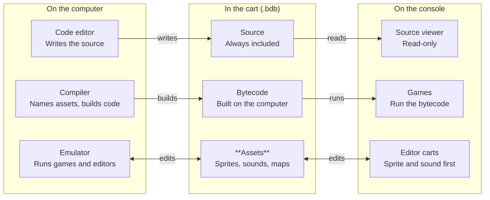

# Bidule 01 — Design Document

Nov 1, 2026 · @Pierre-Clément

## Summary

Bidule 01 is the first hardware revision of the Bidule reboot: an open fantasy console for small games and apps, built on a single cheap microcontroller anyone can source. It ships with its own language, a cartridge format that lives in external flash, and a way to share creations device-to-device with no central server.

The same platform runs three ways: on Bidule 01 hardware, as an emulator on old computers, and on off-the-shelf emulation handhelds (Anbernic-type). A creation made once plays everywhere.

## Philosophy

Bidule is a political object: a statement that play and creation do not need a gaming arms race. It answers AAA excess, upscaling hype (DLSS and the like), RAM shortages driven by ever-larger hardware, and devices built on unethical supply chains or planned obsolescence.

Three principles follow from that stance:

- **Openness.** The platform, its formats and its tools are open. Anyone can build the hardware, write an emulator, or fork the runtime.
- **Accessibility.** Parts are cheap and available anywhere. Hardware can be recycled, scavenged or bought off the shelf; old computers stay useful as Bidule machines.
- **Independence.** Sharing does not depend on a platform owner, a store or a server that can be switched off.

## Goals and non-goals

**Goals**

- One platform, three targets: Bidule 01 hardware, desktop emulator, emulation handhelds.
- Cartridges noticeably larger than previous Bidule programs allowed, by streaming assets from flash instead of holding them in RAM.
- A language and runtime simple enough to learn on the device's own terms.
- Serverless, passive, peer-to-peer sharing.
- Secure by default: a cartridge cannot harm the device, the host or the user's data.
- A design that can be handed off: documented well enough that others can build, maintain and extend it.

**Non-goals**

- Competing on graphics or performance.
- A central store, account system or social network.
- Proprietary or hard-to-source components.
- Running existing retro-console ROMs.

## Target platforms

The Bidule 01 hardware is the reference; the other two targets must behave identically for the same cartridge.

| Target | Role | What it needs |
| --- | --- | --- |
| Bidule 01 hardware | Reference device | MCU, 240×160 screen, external flash, buttons, audio out |
| Desktop emulator | Development and old-computer reuse | Low-spec builds; runs on old machines |
| Emulation handhelds (Anbernic-type) | Ready-made portable option | Port of the emulator to their Linux firmware |

Open question: how sharing works on targets without the hardware's radio (emulator, handhelds).

## Hardware direction

Bidule 01 is a single-chip design: one microcontroller drives display, input, audio and storage. The screen is 240×160 in RGB565, so one full framebuffer is 76,800 bytes. Tile, sprite and audio data stay in external flash and are read in place (XIP) rather than copied to RAM.

The chip choice is still open. The previous prototype ran on the RP2040, but passive sharing needs a radio.

| Option | For | Against |
| --- | --- | --- |
| RP2040 | Existing work (USB mass storage, FAT12 image); very cheap, widely sold | No radio; 264 KB SRAM |
| RP2040 + radio module (e.g. Pico W) | Keeps existing code | Second chip, breaks the single-chip goal |
| ESP32-S3 | Wi-Fi and BLE built in; 512 KB SRAM; XIP flash | Port of existing work; sourcing to be checked |
| RP2350 (Pico 2) | Successor to RP2040, more SRAM | No radio either |

Decision needed: which chip is easiest to source worldwide while carrying a radio.

## Creation and sharing

Creations are written in Bidule's own language, compiled to bytecode and packed into a cartridge image. On hardware, a computer sees the device as a USB drive, so loading a cartridge is a file copy.

Sharing is peer-to-peer with no central distribution server. The model is passive exchange, in the spirit of StreetPass: two devices that come near each other swap a creation without either owner doing anything. This suits a world where few people around any given owner are actively looking for new games.

Every cart carries its source, so anyone who receives one can read how it works on the device itself and take it to a computer to learn from or remix, within its license.

Open questions:

- What a device offers by default (a chosen "calling card" creation, a random one, the latest made).
- How received creations are stored, browsed and kept or discarded.
- Whether an explicit, deliberate share also exists alongside the passive one.

## Authoring workflow

Code is written on the computer; assets (sprites, maps, sounds, music, palette) can be edited on the computer or on the console. Code needs a keyboard and a compiler, assets do not.

The cart is the shared project file: it holds the source, the compiled bytecode and the assets.

- **The cart is a complete project.** The computer toolchain unpacks a cart into a folder (source plus one file per asset) and packs it back. There is no separate project format.
- **Code refers to assets by name** (`Sprites.HERO`, `Sounds.JUMP`). The compiler binds each name to a fixed index, so assets edited on the console show up in the game without recompiling.
- **The editors are Bidule carts.** The same sprite and sound editors run on the console and in the computer's emulator, so there is one tool to learn. Anyone can write a better editor.
- **Editors only touch what the user picks.** An editor asks the system to choose a cart and sees only its assets, never its code. Saving can always produce a copy.
- **Conflicts are visible.** Each asset carries a revision number; packing warns when an asset changed on both sides and keeps both versions.
- **Assets travel on their own.** An asset-only cart (a sprite set, a sound bank) can be shared by peer exchange and imported into another game.

Typical flows: draw sprites on the console during a commute, then plug in and keep coding with them; or copy a game to the console, playtest it, and retune its sounds there while it is in your hands.

### Future direction: code on the device

Writing code on the console is out of scope for Bidule 01, but a later version may allow it on hardware with a keyboard. The compiler is not the obstacle: compiling a maximum-size cart should fit in about 128 KB of RAM, freed while no game runs. The keyboard is.

| Device class | Hardware | Can do |
| --- | --- | --- |
| Player | Any Bidule device | Play, read source, edit assets |
| Creator | At least 512 KB of RAM and a keyboard (USB, Bluetooth or built in) | Also edit and compile code |

Both classes run the same carts. Because every cart carries its source, a Creator device could open a game received by peer exchange and remix it on the spot. To keep this possible, Bidule 01 builds one portable compiler, written in Rust, under a fixed memory budget that holds on every device (see the spec).

## Security by default

Because creations arrive from strangers with no one vetting them, the runtime must treat every cartridge as untrusted. Principles:

- Cartridges run in the bytecode VM only; no native code from a cartridge.
- Bytecode is verified before it runs; all memory access is bounds-checked.
- A cartridge reaches only its own save data and assets, never other cartridges or the system area.
- Peer exchange carries data only and never triggers execution on receipt.
- On desktop and handhelds, the emulator gets no file-system or network access beyond its own folder.

## Lessons from previous iterations

- **Programs were too small.** Earlier Bidule programs felt cramped; Bidule 01 moves assets to XIP flash to lift that limit.
- **USB mass storage works.** The RP2040 prototype exposes storage over USB with TinyUSB.
- **Don't format flash at runtime.** A FAT12 image pre-generated at build time avoided the hazards of formatting flash on the device.
- **The spec had gaps.** A prior review flagged, by priority: language spec gaps, API reference gaps, runtime and audio hazards, and bytecode format ambiguities. The Bidule 01 spec must close these.

## Open questions and next steps

- [ ] Pick the chip: RP2040, RP2350, ESP32-S3, or RP2040 with a radio module.
- [ ] Define the passive-exchange model and what a device offers by default.
- [ ] Decide how emulator and handheld targets take part in sharing.
- [ ] Choose screen, buttons and audio output parts and check worldwide sourcing.
- [ ] Port the earlier language spec into the Bidule 01 spec and close the review's gaps.
- [ ] Write a threat model for cartridges and peer exchange.
