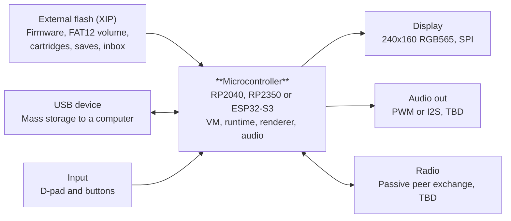

# Bidule 01 — Technical Specification

Nov 1, 2026 · @Pierre-Clément

## Status and conventions

This is a first draft. Only the display format and the flash-resident asset model are decided; everything else is proposed or open. The rationale lives in the Bidule 01 design document.

Each requirement is tagged:

- **Fixed** — decided; changes need a design-doc update.
- **Proposed** — a starting point to confirm or replace.
- **TBD** — not yet decided; listed so the gap stays visible.

The keywords MUST, SHOULD and MAY follow RFC 2119.

## System architecture



The microcontroller is the only processor; graphics and audio assets are read straight from external flash, and the radio is the one part still undecided.

## Hardware profile

| Parameter | Value | Status |
| --- | --- | --- |
| Architecture | Single microcontroller, no co-processor | Fixed |
| MCU | RP2040, RP2350 or ESP32-S3 | TBD |
| Asset storage | External QSPI flash, executed/read in place (XIP) | Fixed |
| Flash size | TBD; sets maximum cartridge size | TBD |
| Display | 240×160, 8-bit indexed colour, RGB565 panel | Fixed |
| Display interface | SPI panel | Proposed |
| Input | D-pad + buttons; count TBD | TBD |
| Audio out | PWM or I2S to speaker/headphone | TBD |
| Host link | USB device, mass-storage class | Fixed (prototyped on RP2040) |
| Radio | Needed for passive exchange; on-chip or module | TBD |
| Power | Battery type and charging TBD | TBD |

All parts MUST be available from several sources and SHOULD be salvageable from common devices.

## Display

The screen is 240×160 pixels. Fixed. Decided: colour is indexed. Each pixel holds a palette index (0–255); a 256-entry palette maps indexes to RGB565 when the frame is sent to the panel.

**Memory**

- Framebuffer: 240 × 160 × 1 byte = 38,400 bytes. Double buffering, if used, takes 76,800 bytes.
- Palette: 256 entries × 2 bytes (RGB565) = 512 bytes.
- Each row is expanded from indexes to RGB565 on its way to the panel (by CPU or DMA).
- Tile and sprite pixel data are stored as indexes, 1 byte per pixel, and read from flash, not copied into RAM.

**Colour in the API**

- Every drawing function takes a palette index as its colour argument.
- `setpal(i, r, g, b)` sets entry `i` from 8-bit components, rounded to RGB565; it takes effect at the next frame flush, without redrawing. `getpal(i, chan)` reads an entry back.
- The palette resets to the default when a cart loads.
- In sprites, one index is transparent: 0 by default, changeable with `palt(i)`.

**Default palette**

Decided: entries 0–15 form a curated palette with built-in names, usable as constants anywhere. Values are given as stored (RGB565) and as the 8-bit hex they expand to.

| Index | Name | Hex | RGB565 |
| --- | --- | --- | --- |
| 0 | `BLACK` | #100C18 | 0x1063 |
| 1 | `DARK_BLUE` | #31346B | 0x31AD |
| 2 | `PLUM` | #422431 | 0x4126 |
| 3 | `DARK_GREEN` | #316521 | 0x3324 |
| 4 | `BROWN` | #844D31 | 0x8266 |
| 5 | `DARK_GREY` | #4A494A | 0x4A49 |
| 6 | `GREY` | #9CA6B5 | 0x9D36 |
| 7 | `WHITE` | #EFF3E7 | 0xEF9C |
| 8 | `RED` | #CE454A | 0xCA29 |
| 9 | `ORANGE` | #D67D29 | 0xD3E5 |
| 10 | `YELLOW` | #DED35A | 0xDE8B |
| 11 | `GREEN` | #6BAA29 | 0x6D45 |
| 12 | `BLUE` | #5A7DCE | 0x5BF9 |
| 13 | `CYAN` | #6BC3CE | 0x6E19 |
| 14 | `MAGENTA` | #AD1073 | 0xA88E |
| 15 | `SAND` | #BDAA5A | 0xBD4B |

- Adapted from mimi16, itself derived from DawnBringer's DB16 palette. The documentation MUST credit both.
- TBD: defaults for entries 16–255 (for example, ramps of each base colour).

**Drawing API** — Proposed (names tried in the browser prototype):

| Call | Effect |
| --- | --- |
| `cls(c)` | Fills the screen with colour `c` (0 if omitted) |
| `pset(x, y, c)` / `pget(x, y)` | Sets or reads one pixel's palette index |
| `line(x0, y0, x1, y1, c)` | Line, both end points included |
| `rect(x, y, w, h, c)` / `rectfill(x, y, w, h, c)` | Outline or filled rectangle, `w`×`h` pixels |
| `circ(x, y, r, c)` / `circfill(x, y, r, c)` | Outline or filled circle of radius `r` |
| `spr(s, x, y)` | Draws sprite `s`; the index set by `palt` is skipped |

- Coordinates and sizes accept int or fix; fix is rounded down.
- Drawing outside the screen is clipped silently.
- A colour argument uses its low 8 bits as the palette index.

**Open**

- Layer count and frame rate target. Tile size and sheet limits are set in Asset section layout.
- Integer scaling — Proposed for the emulator: the largest whole scale that fits (480×320 at 2×); below 2×, fit the space with nearest-neighbour scaling. Handheld rules TBD.

## Input and audio

**Input**

- Proposed button set: a D-pad and two buttons, A and B, readable by carts as `BTN_LEFT`, `BTN_RIGHT`, `BTN_UP`, `BTN_DOWN` (0–3), `BTN_A` (4) and `BTN_B` (5). A system Reset restarts the cart and is never visible to it. The set MUST map cleanly onto Anbernic-type handheld controls and a desktop keyboard.
- Proposed: input state sampled once per frame and exposed as a bitmask (bit `i` set while button `i` is held).
- Proposed: `btn(b)` returns 1 while button `b` is held; `btnp(b)` returns 1 only on the frame it goes from released to held.
- Proposed default keyboard: arrows or WASD for the D-pad, X or K for A, Z or J for B, R for Reset.

* Optional pointer, decided: `haspointer()` returns 1 where a mouse exists (the emulator) and 0 on hardware. `mousex()`, `mousey()` and `mouseb()` read it. Editors use it when present; nothing may require it.
* Proposed for the emulator: a full-screen mode for touch devices. The screen is shown in landscape at the largest whole scale that fits, and the D-pad and A/B are drawn over it as a semi-transparent overlay. Each finger is tracked on its own, so several buttons can be held at once; a finger that slides from one button to another releases the first and presses the second, and the D-pad reads diagonals. The overlay feeds the same button bitmask as the keyboard, so carts cannot tell it apart. A control on the overlay switches between button mode and mouse mode. In mouse mode the buttons are hidden and a finger on the screen drives the pointer (position and left button); in button mode touches on the screen are ignored. A physical mouse works in both modes. System Reset, the mode switch and Exit stay on the host side, outside the cart's reach, in a strip beside the screen: the screen is never under them, so in mouse mode nothing is drawn over it. Where the platform allows it, the mode keeps the browser's own gestures (scroll, pull to refresh, pinch zoom, long press) away from the controls.

**Audio**

Decided: carts describe sounds as data, and native firmware code does the per-sample work. The v0.9 model, where `audio(t)` computed every sample in bytecode, was too costly and could not start a sound in sync with gameplay.

**Mixer**

- Native code on the audio core mixes 5 voices at 16 kHz: 4 synth voices and 1 optional bytebeat voice.
- Mixing works on buffers of at most 128 samples (8 ms), so a sound starts within 8 ms of the call.
- The mixer's cost does not depend on the cart.

**Sound effects**

```
const JUMP: Sound = { wave: SQUARE, from: 220, to: 660, time: 0.12, vol: 0.8 }
const COIN: Sound = { wave: TRIANGLE, notes: "E6 B6", step: 0.05 }
const HIT:  Sound = { wave: NOISE, from: 800, to: 100, time: 0.2 }

update() {
  if (btnp(BTN_A)) { play(JUMP) }
}
```

- `Sound` is a built-in record type. Proposed fields: `wave` (`SQUARE`, `TRIANGLE`, `SAW`, `NOISE`), `from` and `to` (pitch in Hz, glided linearly), `time` (seconds, `fix`), `vol` (0.0–1.0), `attack` and `release` (seconds), `notes` (a text sequence of note names such as `"C4 E4 G4"`, `-` for a rest) and `step` (seconds per note). With `notes`, `from` and `to` are ignored.
- Synthesized waveforms only in v1; recorded samples are deferred.

* Sounds are normally assets: designed in the sound editor, stored in the cart's sound section and played as `play(Sounds.JUMP)`. Constant `Sound` tables in source, as above, remain for quick tests.

- `Sound` also has a `duty` field (0.0–1.0, default 0.5): the pulse width of `SQUARE` waves, which changes their timbre.

* Proposed defaults for fields a `Sound` leaves out: `vol` 1.0, `time` 0.1, `step` 0.1, `duty` 0.5; others 0. Under the general rule (missing fields are 0), the `HIT` example above would be silent.

**API**

| Call | Effect |
| --- | --- |
| `play(s)` | Plays sound `s` on a free synth voice; returns the voice (0–3). With no free voice, replaces the oldest |
| `play(s, v)` | Plays on voice `v`, replacing what it was playing |
| `stop(v)`, `stopall()` | Silences one voice or all of them |
| `playing(v)` | 1 while voice `v` is sounding, else 0 |
| `cue(n)` | Raises cue `n` (0–7) for `audio(t)`, see below |

**Bytebeat voice: `audio(t)`**

- Optional. Only carts that define `audio(t)` pay its cost.
- Keeps its v0.9 behaviour: runs at 8 kHz in the VM, returns an 8-bit sample (128 = silence), reads globals one frame late, owns its `audio var` variables. The mixer upsamples it to 16 kHz.
- `cuecount(n)` inside `audio(t)` returns how many times the game has raised cue `n`. The count is visible immediately, so a bytebeat track can react to gameplay within a few milliseconds by comparing it with a value kept in an `audio var`.

**Open**

- Output stage: PWM or I2S, bit depth, mono or stereo.
- A sound editor tool for designing `Sound` values.
- A tracker-style music format built on the synth voices (later).

## Storage, USB and cartridge format

**USB mass storage** (prototyped on RP2040 with TinyUSB)

- The device MUST appear to a computer as a USB drive; installing a cartridge is a file copy.
- The FAT12 file-system image MUST be generated at build time. The device MUST NOT format flash at runtime.

**Flash layout** — Proposed regions, sizes TBD:

1. Firmware (runtime and VM)
2. FAT12 volume visible over USB
3. Cartridge store, read in place
4. Save data, one slot per cartridge
5. Received-creations inbox for peer exchange

**Cartridge format** — TBD. It MUST define:

- File extensions: `.bdcart` is a cart's source file (see Language); `.bdb` is the compiled cart, the single file that devices store, exchange and run. A `.bdb` holds the bytecode, the source and the assets.
- Header: magic, format version, title, author, size, checksum.
- Compiler version: the version of the compiler that built the bytecode, so a Creator device or the toolchain can pick the matching compiler to recompile the source and check it against the bytecode. The compiler MUST be deterministic: the same source and compiler version always give the same bytes.
- Author identity: the author's public key (Ed25519), and the author's signature over the cart's hash (see the threat model). Identity and signing are specified in the threat model.
- Lineage: the hash of the parent cart when a cart is a remix or a new version of another, empty otherwise.
- Sections: bytecode, source (stored uncompressed), debug info, constant tables, and one section per asset kind: sprite sheet, maps, sounds, music, palette.
- Each asset section carries a name table (name → fixed index) and a revision number.
- Alignment rules so sections can be read in place.
- A size limit, set by flash size; larger than previous Bidule programs. The source section counts toward it, so authors may minify their source to save space.
- One canonical encoding per cart, so that hashes and signatures are stable.
- A cart may hold assets only, with no bytecode: an asset pack (a sprite set, a sound bank) for sharing and importing.

**Sound data** — `Sound` values are ordinary constant tables or records and live in flash with the rest of the cart's data (see Input and audio).

**Authoring and source** — Decided:

- Code is written and compiled on a computer; the device has no code editor or compiler. Assets can be edited on either side (see Asset editing below).
- The cart carries its source alongside the bytecode, in an uncompressed section: no decompressor is needed on the device, and the format stays simple to parse (see the threat model). The device MUST let a user read the source of any cart it holds, including carts received by peer exchange, and copy it to a computer over USB.
- Proposed metadata: `@license` (shown on the device beside the source; the cart template starts with an open license the author can change) and `@spoilers` (the device warns before showing the source).
- Decided: source is always included; authors cannot leave it out. Bytecode can be decompiled anyway, readable carts are the platform's openness made concrete, and readable code lets anyone check what arrives from strangers.
- Decided: the source may be minified or obfuscated; the rule is that it is present and recompiles to the cart's bytecode, not that it is easy to read. Anyone with the compiler version named in the header can check this locally; no server is involved. The toolchain SHOULD ship a canonical formatter that restores layout to minified source.

**Asset editing** — Decided:

- **A cart is a complete project.** The computer toolchain unpacks a cart into a folder (the source file plus one file per asset kind) and packs a folder back into a cart.
- **Stable indexes.** The compiler binds each asset name to its index in the asset's name table. On the console, an editor may change any asset's content and append new assets; it may not reorder or delete them. Deleting empties the slot and keeps its index. A cart edited this way keeps running correctly without recompiling; new assets become usable from code after the next compile.
- **Revisions and conflicts.** Each save increments its section's revision number, shown to users. Conflicts are detected by CRC: the toolchain records each section's CRC at unpack time and, when packing, warns if the cart's CRC differs, keeping both versions.
- **Editors are carts.** The sprite and sound editors ship first; map and music editors follow. They run the same way on the console and in the emulator.

**Editing API** — available to any cart; access always goes through the system:

| Call | Effect |
| --- | --- |
| `pickcart(kind)` | Shows the system cart picker; the user chooses a cart. Returns a handle, or −1 if cancelled. `kind` names the asset section the editor wants (`"sprites"`, `"sounds"`, ...) |
| `readasset(h, dst, i)` / `writeasset(h, src, i)` | Read or write asset `i` of the picked section into or from an array |
| `assetcount(h)`, `assetname(h, i, dst)`, `setassetname(h, i, name)` | Inspect and name assets; new names extend the name table |
| `savecart(h)` | The system asks the user to overwrite the cart or save a copy, then writes it |
| `opensection(h, kind)` | Proposed. Opens another asset section of the cart behind `h`, without showing the picker; returns a new handle |
| `cartname(h, dst)` | Proposed. Writes the picked cart's title into `dst`; returns its length |
| `drawasset(h, i, x, y)` | Proposed. Draws tile or sprite `i` of the picked section at (`x`, `y`), skipping the `palt` index |
| `status(text)` | Proposed. Sets the system status line; `status("")` clears it |

- An editor sees only the asset section it asked for, of the cart the user picked. Source, bytecode and other sections stay out of reach.
- Nothing is written until `savecart` and the user's confirmation.
- readasset and writeasset exchange a slot's raw bytes, one byte per array element, in the layouts defined below. Tiles of the sheet are addressed as slots of kind "tiles".

**Editor support** — Proposed, from building the Sprite Editor in the browser prototype:

- **One pick covers the cart's asset sections.** Choosing a cart in the picker lets the editor call `opensection` on any of its asset sections, never its source or bytecode. A map editor opens `"maps"`, then `"tiles"` of the same cart. `savecart(h)` on any handle from that pick saves every section changed through it, with one confirmation.
- **`drawasset`** exists because `spr` draws only from the running cart. Redrawing a 16×4 tile window pixel by pixel took about 55 ms per scroll in the prototype; on hardware it would cost more.
- **`cartname`** lets an editor show which cart it is editing.
- **Status line.** The system draws the `status` text over the bottom 9 pixel rows after `draw()`, in the default palette. Every editor then shows its button hints in the same place and style.

**Compiler constraints** — Decided, so that a future Creator-class device can compile on the console:

- There is one compiler implementation, written in Rust as a `no_std` crate (with `alloc`). It is built for desktop, the browser (WebAssembly), Linux handhelds and, later, the microcontroller. The VM is a separate `no_std` crate that the compiler does not depend on beyond the shared bytecode definition.
- The compiler MUST compile any valid cart within 128 KB of working RAM, including on Creator-class devices that have more. Automated tests enforce this with maximum-size carts. Richer analysis (linting, formatting, extra diagnostics) may live in a separate host-only tool, but never changes the bytecode.
- Status: not met yet. The first compiler keeps the whole syntax tree in memory and peaks around 700 KB on the Sprite Editor; a test records current levels against regressions until it compiles one function at a time.
- A new language feature is accepted only if it fits this budget; features needing unbounded whole-program analysis are rejected.

**Asset section layout** — Decided. All multi-byte values are little-endian; sections are read in place from flash.

*Common container*

| Part | Content |
| --- | --- |
| Header (16 B) | Kind (u8), format version (u8), revision (u16), slot count (u16), flags (u16), payload CRC-32 (u32), reserved (4 B) |
| Name table | Per slot: name length (u8), then the name. Length 0 = unnamed. Names follow identifier rules, at most 24 characters |
| Slot table | Per slot: offset (u32) and length (u32) into the payload. Length 0 = emptied slot, index kept |
| Payload | Kind-specific data |

*Sprites*

| Part | Layout |
| --- | --- |
| Tile sheet | Up to 1,024 tiles of 8×8 pixels (a 256×256 px sheet, 64 KB). 1 byte per pixel, a palette index; rows top to bottom, pixels left to right. Tile t starts at byte t × 64 |
| Tile flags | 1 byte per tile: 8 flags, read with `fget(tile, flag)` (flag 0–7) |
| Named sprites (slots) | 4 bytes each: first tile (u16), width in tiles (u8), height in tiles (u8) |

*Sounds* — each slot is a 16-byte record followed by its notes:

| Offset | Size | Field |
| --- | --- | --- |
| 0 | 1 | Wave: 0 square, 1 triangle, 2 saw, 3 noise |
| 1 | 1 | Volume, 0–255 |
| 2 | 1 | Duty cycle for square, 0–255 (128 = 50%) |
| 3 | 1 | Note count; 0 = glide from `from` to `to` |
| 4 | 2 | From, Hz |
| 6 | 2 | To, Hz |
| 8 | 2 | Time, ms |
| 10 | 2 | Attack, ms |
| 12 | 2 | Release, ms |
| 14 | 2 | Step per note, ms |
| 16 | n | Notes, 1 byte each: MIDI number (C4 = 60), 0 = rest |

The source form of a `Sound` (note names, seconds as `fix`, volume 0.0–1.0, `duty` 0.0–1.0 with 0.5 by default) is converted by the compiler or the editor.

*Maps* — each slot is one named map: width and height in cells (u16 each), then one tile index (u16) per cell, row by row. Maps are read-only: `Maps.LEVEL1[ty][tx]` reads a cell, and `map(m, cx, cy, x, y, w, h)` draws `w`×`h` cells starting at cell (`cx`, `cy`) at screen position (`x`, `y`), skipping tile 0. A game that changes its map copies the cells it needs into a `var` array.

*Palette* — no slots: 256 RGB565 entries (u16), 512 bytes. A cart without a palette section uses the default palette.

*Music* — kind reserved; layout TBD with the tracker format.

## Runtime, VM and bytecode

Cartridges run as bytecode in a virtual machine; the VM is the only thing that executes cartridge code. Fixed by the security model.

The byte-level format — container, sections, opcode table, built-in ids, handles and verifier rules — is specified in [Bytecode and cart image format](bytecode.md) (Proposed), and implemented by the Rust crates in `crates/`.

- The bytecode format MUST be specified byte for byte: encoding, endianness, opcode table, operand sizes, constant pools. The prior review found ambiguities here.
- Bytecode MUST be verified at load: valid opcodes, jump targets inside the code section, stack depth bounded.
- Every memory access MUST be bounds-checked against the cartridge's own RAM and asset sections.
- Proposed: a fixed per-frame instruction or time budget, with defined behaviour when exceeded. The first implementation uses 2,000,000 instructions per handler call (see bytecode.md › Execution).
- Proposed, from the first implementation: a 512-value stack, 512 local slots and 16 frames on the main core; 64 values and 64 locals on the audio core; about 30 KB of VM RAM in all. TBD: error and crash screen behaviour.

## Language

The cart language stays a small, integer-only, imperative language compiled to stack bytecode, as in spec v0.9. This revision adds declarations, local variables, constants and a debug mode, and lays out options for fixed-point math, records and byte strings. Everything here is Proposed until reviewed.

### Changes from v0.9

| # | Change | Why |
| --- | --- | --- |
| 1 | Local variables and parameters live in the call frame | Parameters in global slots broke recursion; shared loop counters clobbered callers |
| 2 | Declarations use `var`; assigning an undeclared name is an error | v0.9 used the same syntax to declare and assign, so typos were ambiguous |
| 3 | Debug mode traps out-of-bounds access and division by zero with a source line | Silent failures hid bugs during development |
| 4 | `const` with compile-time folding; built-in names for buttons, screen size and colours | Removes magic numbers without spending global slots |
| 5 | `&&` and `\|\|` return 0 or 1 | Predictable truth values; v0.9 returned an operand |
| 6 | `!` added to the precedence table; metadata key is `title` everywhere | Consistency fixes from the review |
| 7 | A `fix` type (16.16 fixed-point) with trig in degrees and `sqrt` | Sub-pixel movement and angles without `fmul` or shifts, still bit-exact |
| 8 | Array initializers and 2D arrays | Data and grids without manual setup loops or index arithmetic |
| 9 | Records, nestable, with arrays inside, passed by reference | Entities without hand-aligned parallel arrays |
| 10 | Constant tables stored packed in flash | Levels, text and game data beyond the 16 KB pool |
| 11 | `sprite` declarations | Named sprites instead of tile numbers |
| 12 | String interpolation, `fmt`, `textwidth`; `print` colour optional | Text with values and formatting in one call |
| 13 | Conditional expression `? :` | Choosing a value inline |
| 14 | enum and switch without fall-through; type edge cases and evaluation order defined | State machines without magic numbers; one behaviour for compiler and emulator |
| — | Byte strings for mutable text | Open, see below |

Kept from v0.9: integer-only arithmetic, no dynamic allocation, single-file carts, the `init`/`update`/`draw`/`audio` lifecycle, and the bytebeat-style `audio(t)` model.

### Program structure and lexical rules

A cart's source is one file (`.bdcart`); compiling it produces the `.bdb` cart (see Cartridge format). A source file holds metadata comments, then top-level declarations, functions and lifecycle handlers in any order. Names are resolved across the whole file, so a function may call one defined below it.

- **Metadata:** `// @key value` lines before the first declaration. Keys: `title`, `author`, `version`, `desc`, `id`. Unknown keys produce a warning.
- **Comments:** `//` to end of line.
- **Identifiers:** ASCII letters, digits and `_`, not starting with a digit. Case-sensitive.
- **Keywords:** `var` `const` `fn` `audio` `fix` `record` `sprite` `enum` `switch` `if` `else` `while` `for` `break` `continue` `return`. The lifecycle names `init` `update` `draw` are reserved at top level.
- **Integer literals:** decimal (`42`), hex (`0x2A`), binary (`0b101010`); `_` allowed as a digit separator (`1_000`).
- **Fix literals:** digits with a decimal point (`0.05`, `12.5`); rounded to the nearest 1/65,536.
- **Char literals:** `'A'` is the int 65. Escapes `'\''` and `'\\'`.
- **String literals:** printable ASCII 32–126, escapes `\"` and `\\`, at most 255 characters, with {expr} interpolation (see Text output).
- **Statements** end at the end of the line; no semicolons except inside `for (...)`. Inside `{ }` initializers, newlines are ignored.

### Declarations and scope

Every name is declared exactly once with `var`, `const`, `fn` or `audio var`. Assigning to a name that was never declared is a compile-time error, with a suggestion when a close match exists (`unknown variable 'scroe' — did you mean 'score'?`).

```
const SPEED = 2          // compile-time constant, folded away
const MAX_X = SCREEN_W - 8

var score = 0            // global int
var lives                // global int, starts at 0
var buf[64]              // global array, zero-filled
var name = "player1"     // global array, null-terminated char codes

audio var phase = 0      // audio-local int, see below

fn sum(a[], n) {
  var total = 0          // local int
  for (var i = 0; i < n; i++) {   // i is local to the loop
    total += a[i]
  }
  return total
}
```

**Scope rules**

- `var` at top level declares a global. `var` inside a function or handler declares a local, visible from its declaration to the end of the enclosing block.
- Parameters are locals of the function.
- Locals are int or fix in v1. Arrays and records are global.
- A local may not reuse the name of a global, a constant, a function or another local in an enclosing block (compile-time error). No shadowing means a name always refers to one thing.
- Each call gets fresh locals, so recursion works as expected.

**Constants**

- `const NAME = expr`, top level only. `expr` uses only literals, other constants and operators; it is evaluated at compile time and uses no global slot.
- Built-in constants: `BTN_LEFT` `BTN_RIGHT` `BTN_UP` `BTN_DOWN` `BTN_A` `BTN_B` (0–5), `SCREEN_W`, `SCREEN_H`.

**Audio-local variables**

- `audio var NAME = number`, top level only, int only. Readable and writable only inside `audio(t)`, as in v0.9.

**Limits**

| Limit | Value |
| --- | --- |
| Global ints | 256 |
| Global arrays | 255 |
| Array pool | 4,096 ints (16 KB) |
| Audio-local ints | 64 |
| Locals + parameters per function | 64 |
| Local slots across all active frames | 512 (2 KB) |
| Call depth | 16 frames |

### Types, integer semantics and operators

Three types: `int` (signed 32-bit), `fix` (signed 16.16 fixed-point, see below) and arrays of either. There is no boolean type: 0 is false, any other value is true.

- Arithmetic wraps on overflow (two's complement). Wraparound is intended and stays silent in debug mode, since bytebeat audio relies on it.
- `/` truncates toward zero; `%` satisfies `a == (a / b) * b + (a % b)`.
- Division or modulo by zero yields 0 in release mode and traps in debug mode.
- Shift counts are masked to 0–31. `>>` is arithmetic (sign-extending).
- Comparisons, `!`, `&&` and `||` return 0 or 1.
- `&&` and `||` short-circuit.

| Precedence | Operators | Associativity |
| --- | --- | --- |
| 11 | Unary `-` `!` `~` | Right |
| 10 | `*` `/` `%` | Left |
| 9 | `+` `-` | Left |
| 8 | `<<` `>>` | Left |
| 7 | `<` `<=` `>` `>=` | Left |
| 6 | `==` `!=` | Left |
| 5 | `&` | Left |
| 4 | `^` | Left |
| 3 | `\|` | Left |
| 2 | `&&` | Left |
| 1 | `\|\|` | Left |
| 0 | `? :` | Right |

Three changes from v0.9: && now binds tighter than ||, `~` (bitwise not) is added, and equality now binds looser than ordering, as in C and JavaScript. Mixing `&&` and `||` without parentheses is a compile-time warning.

### The fix type

Decided: fractional values use a `fix` type, a signed 32-bit number with 16 integer bits and 16 fraction bits. Range is about ±32,768, step 1/65,536. It is computed with integer instructions only, so results are bit-exact on hardware, emulator and handhelds. The compiler tracks types; the VM does not.

```
const THRUST: fix = 0.05

var px: fix = 80
var vx: fix
var xs: fix[16]               // array of fix

fn speed(dx: fix, dy: fix): fix {
  return sqrt(dx * dx + dy * dy)
}
```

**Declaring**

- `: fix` after a name declares a fix variable, constant, parameter, array or return type. Without it, the type is `int`.
- A number literal with a decimal point (`0.05`, `1.0`) is a fix literal. Integer literals fit either type.

**Mixing int and fix**

- In arithmetic and comparisons, an `int` operand is promoted to `fix` automatically. The result is `fix`.
- `fix` never converts to `int` silently: assigning a fix to an int is a compile-time error. Use `int(x)`, which rounds down (toward −∞), or `round(x)`.
- Built-ins that take coordinates or sizes (`pset`, `line`, `rect`, `spr`, `print` position, ...) accept `int` or `fix`; a fix is rounded down. Drawing never needs `int()`.
- Bitwise operators (`& | ^ ~ << >>`) require `int`.

**Arithmetic**

- `+`, `-` and comparisons work as on integers. `*` and `/` are fixed-point operations using a 64-bit intermediate; the compiler picks them from the types.
- Overflow wraps, as for `int`. Division by zero follows the same release and debug rules as `int`.

**Math built-ins**

| Function | Takes | Returns |
| --- | --- | --- |
| `sin(a)`, `cos(a)` | Angle in degrees, `int` or `fix`, any value | `fix` in −1.0..1.0 |
| `atan2(dy, dx)` | `int` or `fix` | `fix` angle in degrees, 0 to under 360 |
| `sqrt(x)` | `fix` | `fix` |
| `int(x)`, `round(x)`, `frac(x)` | `fix` | `int`, `int`, `fix` |
| `abs`, `min`, `max`, `clamp` | Either type | Same type as the arguments |

All math functions use one shared integer implementation on every target. `fix` is allowed in `audio(t)` and in audio-local variables.

**Angles** — decided: degrees. 90 is a right angle, 360 a full turn, and plain ints work (`angle += 3`). Requirements:

- `sin` and `cos` reduce any angle modulo 360 themselves; negative angles and angles past 360 are valid.
- Results at multiples of 90° are exact: `sin(0) == 0`, `sin(90) == 1.0`, `sin(180) == 0`, `sin(270) == -1.0`, and likewise for `cos`.
- Results are symmetric: `sin(-a) == -sin(a)` and `sin(180 - a) == sin(a)`, so shapes traced in equal steps close exactly.
- Because 65,536 is not a multiple of 360, a `fix` angle that overflows (past about 91 turns) jumps by 16°. Documentation teaches `angle %= 360` after turning, and debug mode warns about large angles (see Errors).

**Random numbers** — Proposed: `rnd(n)` returns an int from 0 to n−1 and `srand(seed)` sets the seed. The generator MUST be one fixed integer algorithm (TBD, for example xorshift32), so a seed gives the same sequence on every target. The console seeds it at cart load.

### Type rules and evaluation order

Decided.

| Case | Rule |
| --- | --- |
| Compound assignment (`x += 0.5` with `x: int`) | Same rule as plain assignment: a `fix` result into an `int` target is a compile-time error |
| `++` / `--` on `fix` | Allowed; adds or subtracts 1.0 |
| `%` on `fix` | Allowed; same sign rule as `int` (`-7.5 % 2` is `-1.5`) |
| `int / int` assigned to `fix` | Integer division happens first (`7 / 2` gives `3.0`); the compiler warns and suggests `7.0 / 2` |
| Return values | A function without `: fix` returning a `fix` is a compile-time error; an `int` returned from a `: fix` function is promoted |
| `int` beyond ±32,767 promoted to `fix` | Wraps like any overflow; debug mode warns once with the source line |
| `int` literals | Must fit in 32 bits; hex up to `0xFFFFFFFF`, values above `0x7FFFFFFF` read as negative |
| `fix` literals | Must fit in ±32,767.99; otherwise a compile-time error |

**Evaluation order**

- Operands and function arguments are evaluated left to right.
- In `a[i] = expr`, the index is evaluated before the right side. In `a[i] += expr`, the index is evaluated once.
- `&&`, `||` and `? :` evaluate only the operands they need.
- Assignments are statements, not expressions, so evaluation order only matters through function calls.

### Functions, lifecycle and control flow

**User functions**

```
fn clamp_speed(v, lim) {
  if (v > lim) { return lim }
  if (v < -lim) { return -lim }
  return v
}
```

- `fn name(params) { ... }` at top level. A parameter written `name[]` takes an array by reference; others take an int by value.
- Functions return an int with `return expr`. Falling off the end, or a bare `return`, returns 0.
- Wrong argument count or kind (int vs array) is a compile-time error.
- A string literal may be passed to an array parameter only if the function never writes to it; the compiler checks this.

**Lifecycle handlers** — unchanged from v0.9, written without `fn`:

| Handler | Called | Notes |
| --- | --- | --- |
| `init()` | Once after load |  |
| `update(frame, input)` | Every frame, before `draw` | `input` = held-button bitfield |
| `draw(frame, input)` | Every frame, after `update` |  |
| `audio(t)` | Every sample, on the audio core | `return` sets the sample; may not write globals or call user functions |

Parameter names of handlers may be chosen freely; their position fixes their meaning. Unused parameters may be omitted (`update()` is valid).

**Control flow**

- `if (c) { } else if (c) { } else { }` — `else if` is allowed; braces are required otherwise.
- `while (c) { }`, `for (init; cond; step) { }`; `for` may declare its counter with `var`.
- `break` and `continue` apply to the innermost loop.
- Release mode has no loop limit; debug mode warns when one frame exceeds its time budget.

**Enums** — decided:

```
enum State { TITLE, PLAYING, PAUSED, GAME_OVER }
enum Speed { SLOW = 1, FAST = 4 }

var state = State.TITLE
```

- `enum Name { ... }` at top level declares `int` constants, numbered from 0 unless a value is given; a member without a value is the previous one plus 1.
- Members are always written with the enum's name as prefix (`State.PLAYING`), so they never collide with other names. They use no global slot.

**Switch** — decided:

```
switch (state) {
  State.TITLE { draw_title() }
  State.PLAYING, State.PAUSED { draw_level() }
  else { draw_game_over() }
}
```

- Each case is one or more constant values followed by a block. There is no `case` keyword, no `break` and no fall-through.
- `else` runs when no case matches. Duplicate case values are a compile-time error.
- A `switch` on an enum member that lists some members but has no `else` gets a warning naming the missing ones.
- `break` and `continue` inside a case refer to the enclosing loop.

**Local arrays** — deferred. They would make call frames variable in size and let one recursive call exhaust the local stack; global arrays and records cover current needs.

### Arrays and strings

- Arrays are global, fixed-size, and allocated from the shared 4,096-int pool at load. Elements are `int` or `fix` (`var xs: fix[16]`).
- Initializers list the first values; the rest start at 0. With `[]`, the size is the number of values.
- Two-dimensional arrays are sugar for row-major indexing: `grid[y][x]` on `var grid[12][16]` is element `y * 16 + x`. `grid.length` is 12; `grid[0].length` is 16.
- `a[i]` reads or writes an element; compound assignment works on elements (`a[i] += 1`).
- Arrays never alias: assigning one array to another is a compile-time error. Copy with a loop or a built-in.
- `==` on arrays is a compile-time error; use `streq(a, b)` or `arreq(a, b, n)`.
- Out of bounds: release mode reads 0 and ignores writes; debug mode traps. For 2D arrays each index is checked separately.

```
var speeds[] = {1, 2, 4, 8}     // size 4
var scores[10] = {100, 50}      // scores[2..9] are 0
var grid[12][16]                // 192 ints, zero-filled
```

Strings are arrays of character codes ending with 0. A string literal in a declaration creates a mutable array; a literal inside an expression is a temporary, read-only array usable only where a read-only array is accepted (`print`, `streq`, read-only parameters).

Each character of a mutable string takes a full 4-byte int in the pool. Read-only text in constant tables is packed (see below).

### Records

Decided: named record types group related values. They are compiled to one parallel array per field, so they have no runtime cost and the VM never sees them.

```
record Vec2 { x: fix, y: fix }

record Enemy {
  pos: Vec2
  vel: Vec2
  path: int[8]
  hp
}

var enemies: Enemy[16]
var player: Enemy                // a single record: plain globals

fn hurt(e: Enemy, dmg) {         // e is a reference
  e.hp -= dmg
}

fn remove(es: Enemy[], i, count) {
  es[i] = es[count - 1]          // copies every field, path included
}

update() {
  for (var i = 0; i < enemies.length; i++) {
    enemies[i].pos.x += enemies[i].vel.x
    hurt(enemies[i], 1)
  }
}
```

**Declaring**

- `record Name { field: type ... }` at top level. Fields are separated by commas or newlines.
- A field is `int`, `fix`, another record, or a fixed-size array of any of these (`path: int[8]`, `wps: Vec2[4]`).
- A record type may not contain itself, directly or indirectly (compile-time error).
- `var x: Name` declares one record (each field becomes a one-element array, so the record can be passed by reference); `var xs: Name[N]` declares an array of records. Both are global in v1.

**Using**

- Field access chains freely: `enemies[i].pos.x`, `enemies[i].path[j]`.
- Assigning a record to a record of the same type copies every field: `es[i] = es[j]`, `player = enemies[0]`.
- `==` on records is a compile-time error.
- `.length` on a record array is its element count.

**Functions**

- A parameter `e: Name` takes one record by reference; `es: Name[]` takes a record array by reference. Writes through either change the caller's data.
- Arguments can be a single record, an array element (`enemies[i]`) or a nested part (`enemies[i].pos`, passed to `p: Vec2`).
- Functions cannot return records in v1. Use an output parameter: `fn add(a: Vec2, b: Vec2, out: Vec2)`.

**Cost and limits**

- Each flattened field is one array declaration and counts against the limit of 255. Its size is the product of the counts along its path: `Enemy[16]` with `path: int[8]` uses 128 ints for `path`.
- The compiler prints a memory summary per record type and per variable.
- Debug errors name fields as written (`enemies[3].path[9]`), never by internal flattened names.

### Constant tables

Decided: a `const` declared with brackets is a read-only table stored in cart flash and read in place. It uses none of the 16 KB array pool, so carts can carry far more data than RAM allows.

```
const STEPS[] = {0, 3, 7, 12, 15}
const GRAVITY: fix[] = {0.1, 0.15, 0.25}
const TITLE = "BIDULE QUEST"            // text, null-terminated

const ROOM[4][16] = {
  "################",
  "#..@...#...$...#",
  "#......#.......#",
  "################",
}

record Weapon { damage, speed: fix, cooldown }

const WEAPONS: Weapon[] = {
  { damage: 1, speed: 4.0, cooldown: 8 },
  { damage: 3, speed: 2.5, cooldown: 20 },
}

if (ROOM[y][x] == '#') { spr(WALL, x * 8, y * 8) }
fire(WEAPONS[current].speed)
```

**Declaring**

- Element types: `int`, `fix`, or a record type. Values are constant expressions, evaluated at compile time.
- `[]` takes its size from the values; an explicit size may be larger, and missing values are 0.
- Record values may name their fields (`{ damage: 1 }`) or list them in order (`{1, 4.0, 8}`). Missing fields are 0.
- Inside a table initializer, a string literal expands to its character codes. In a 2D table, each string fills exactly one row, with no terminator; a row of the wrong length is a compile-time error. A standalone text constant (`const TITLE = "..."`) ends with 0, so `print` can use it.

**Packing**

- The compiler stores each table, or each field of a record table, at the narrowest width that holds all its values: 1, 2 or 4 bytes, signed or unsigned. Reading always returns a full `int` or `fix`. Packing is invisible to the program.
- A 16×12 text-drawn room therefore takes 192 bytes of flash.

**Using**

- Indexing, 2D indexing, field access and `.length` work as on arrays.
- Writing to a constant table is a compile-time error.
- A constant table may be passed to a function only through a parameter the function never writes to; the compiler checks this.
- Copying into a mutable array is explicit: a loop, or `copy(dst, src)`.
- Out-of-bounds reads follow the array rules: 0 in release mode, a trap in debug mode.

**Limits**

- Up to 65,535 elements per table. Total size is bounded by the cartridge size limit (TBD with flash size).

### Sprite declarations

Decided: sprites are named in source instead of addressed by tile number.

```
sprite HERO = 0              // tile 0, 1×1 tile (8×8 px)
sprite BOSS = 32, 2, 2       // tile 32, 2×2 tiles (16×16 px)

spr(HERO, px, py)
spr(BOSS, bx, by)            // draws all four tiles
```

- `sprite NAME = tile` or `sprite NAME = tile, width, height` (width and height in tiles, default 1), top level only.
- A sprite name is a compile-time constant usable wherever `spr` expects a sprite; it uses no global slot.
- A sprite that extends past the edge of the sheet is a compile-time error.
- Kept minimal on purpose: sheet format, tile maps and sound assets depend on the colour model and flash layout, still open.

**Asset names** — decided: assets named in the cart's asset sections are available in code under a prefix per kind, generated by the compiler from the name tables.

```
spr(Sprites.HERO, x, y)
play(Sounds.JUMP)
var tile = Maps.LEVEL1[ty][tx]
```

- Prefixes: `Sprites`, `Maps`, `Sounds`, `Music`. Each name is a compile-time constant bound to the asset's fixed index.
- `sprite` declarations in source remain valid for quick tests; they live in the source's own namespace and never collide with `Sprites.` names.
- Referring to an asset name that no longer exists, or whose slot was emptied, is a compile-time error.

### Text output

Decided: string literals support interpolation, resolved at compile time.

```
print("Score {score:04}", 4, 2)               // Score 0120, in WHITE
print("HP {hp}/{max_hp}", 4, 12, RED)
print("Pos {x},{y}\nLevel {lvl}", 4, 32)

var w = textwidth("GAME OVER")
print("GAME OVER", (SCREEN_W - w) / 2, 70, RED)

var x = print("HP ", 4, 2)
print("{hp}", x, 2, hp < 3 ? RED : GREEN)

var msg[32]
fmt(msg, "{name} found {n} coins")
```

**Interpolation**

- `{expr}` inside a string literal inserts the value of any expression. `int` prints as decimal; `fix` with up to 4 decimals, trailing zeros dropped; arrays and constant text print as text up to their first 0.
- An optional format follows a colon: width `{n:4}`, zero padding `{n:04}`, fixed decimals `{v:.1}`, hexadecimal `{n:x}`, character `{c:c}`. Formats combine where meaningful (`{v:6.2}`).
- `{{` and `}}` print literal braces. `\n` starts a new line.
- An interpolated literal is accepted wherever a read-only text argument is (`print`, `fmt`, `textwidth`); it cannot be stored in a variable.
- The compiler stores each template as a small descriptor in flash; native firmware code formats the values. No parsing happens at runtime.

**Functions**

| Call | Effect |
| --- | --- |
| `print(text, x, y)` / `print(text, x, y, c)` | Draws text; `c` defaults to `WHITE`. Returns the x position after the last character |
| `fmt(dst, text)` | Writes the formatted text into array `dst`, null-terminated and truncated to fit; returns its length |
| `textwidth(text)` | Width in pixels of the formatted text (widest line) |

The font stays Monogram, 6×9 px per character: 40 columns by 17 lines on the 240×160 screen.

**Conditional expression**

- `cond ? a : b` evaluates `cond`, then only one of `a` or `b`. It has the lowest precedence and groups right to left.
- If one branch is `int` and the other `fix`, the result is `fix`.

### Errors: debug mode and release mode

The same bytecode runs in two modes. Release mode never stops a cart for a recoverable fault; debug mode stops at the first one and shows where it happened.

| Fault | Release mode | Debug mode |
| --- | --- | --- |
| Array read out of bounds | Returns 0 | Stops: array name, index, size, source line |
| Array write out of bounds | Ignored | Stops, same details |
| Division or modulo by zero | Result 0 | Stops with source line |
| Integer overflow | Wraps | Wraps (intended behaviour) |
| Angle beyond ±3,600° passed to `sin`/`cos` | Computed normally | Warning once, with source line, suggesting `angle %= 360` |
| Call depth or local stack exceeded | Stops with error screen | Stops with call trace |
| Frame over budget | Next frame starts late | Warning overlay with frame time |
| Fault inside `audio(t)` | Sample is silence (128) | Silence, fault logged once with source line |

- Debug mode is the default in the desktop emulator and on handhelds; release mode is the default on hardware. Both MUST be selectable on every target.
- For source lines, the compiler emits an optional line table section (see bytecode impact). Carts without it still run; debug errors then show bytecode offsets.
- Compile-time errors show file, line, column, a one-line message and, where possible, a suggested fix.

### Options to decide

Fixed-point math (the fix type), records and constant data are decided; see their sections above. One language choice remains.

**Byte strings for mutable text** — constant text is already packed in flash, so this only concerns text a cart edits at runtime (a name entry, a message log), where each character costs 4 bytes of the 16 KB pool.

| Option | What it looks like | Trade-off |
| --- | --- | --- |
| A. Byte arrays | `var name: bytes[32]`; elements 0–255; string literals become byte arrays | 4× denser text and maps; a second array kind in the VM |
| B. Keep int arrays | No change | Simple; text-heavy carts run out of pool |

Recommendation: defer (B) until a real cart runs short of pool space; constant tables cover most text and map data.

Colour is decided: drawing takes palette indexes, with 16 named default colours (see Display).

### Bytecode impact

These changes raise the `.bdb` format version from 1 to 2. Version 1 carts can be recompiled from source; the VM need not run both.

| Change | Bytecode | Notes |
| --- | --- | --- |
| Local variables | `LOCAL_LOAD 0x07 u8`, `LOCAL_STORE 0x08 u8` | Slot relative to the current frame |
| Call frames | `CALL_FN` moves its `argc` arguments into locals 0..argc−1 of a new frame | Function table: `param_slots` replaced by `local_count` (u8) |
| Handler locals | Header gains a `local_count` byte per lifecycle handler | Handler parameters become locals 0..n |
| Bitwise not | `BNOT 0x25` | For `~` |
| Truth values | `BOOL 0x37`: nonzero → 1 | Ends each `&&` / `\|\|` sequence |
| Fix multiply and divide | `FMUL 0x16`, `FDIV 0x17` | 64-bit intermediate, result shifted by 16 |
| Int ↔ fix | None | `<< 16` to promote; `>> 16` (arithmetic) for `int(x)` |
| Fix math | New built-in ids for `sin`, `cos`, `atan2`, `sqrt`, `copy` | Called through `CALL`; `round` and `frac` compile to an add, shifts and a mask |
| Array initializers | Array declaration table stores initial values at a declared width (1, 2 or 4 bytes) | Replaces v0.9's u8 char-code-only init |
| 2D arrays | None | Compiled to `y * width + x` |
| Records | None for layout; `ARR_GET_DYN 0x74`, `ARR_SET_DYN 0x75` for references | Fields of one record array get consecutive array slots, so a reference is two values: first slot and index |
| Constant tables | New flash section with a table directory (offset, count, width, signedness); `ROM_GET 0x78 u16`, `PUSH_ROM 0x79 u16` | Read in place; `PUSH_ROM` makes a read-only array reference |
| Read-only references | Array references carry a kind bit (pool or flash) | `ARR_GET_DYN` reads either; writes to flash are rejected by the compiler |
| Sprite declarations | None | Compile-time constants |
| Constants | None | Folded to `PUSH_INT` by the compiler |
| Debug section | Optional, flags bit 1: line table + name map for flattened record fields | Debug errors show source names |
| Byte arrays (if chosen) | `ARR_GET8`, `ARR_SET8` | Separate byte pool or byte-addressed pool |

Types exist only in the compiler; the VM sees 32-bit values and does not tag them. The complete opcode table, including the 2D access, row and text-template instructions the first implementation added, is in [bytecode.md](bytecode.md).

The audio core keeps its own 64-slot local stack, since `audio(t)` may declare locals. RAM cost of locals: 2 KB (main core) + 256 B (audio core).

### Grammar

Statements are separated by newlines (`NL`). Byte arrays are not included until decided.

```
program       := (top_level NL*)*
top_level     := const_decl | var_decl | audio_decl | record_decl | enum_decl
               | sprite_decl | fn_def | handler

type_name     := 'int' | 'fix' | IDENT              // IDENT = a record type
type_ref      := type_name dims?
dims          := ('[' expr? ']')+
shape         := dims | ':' type_ref               // dims after the name, or after the type

const_decl    := 'const' IDENT shape? '=' init
var_decl      := 'var' IDENT shape? ('=' init)?
audio_decl    := 'audio' 'var' IDENT (':' type_name)? '=' expr
record_decl   := 'record' IDENT '{' NL* field ((',' | NL+) field)* ','? NL* '}'
field         := IDENT (':' type_ref)?
sprite_decl   := 'sprite' IDENT '=' expr (',' expr ',' expr)?
enum_decl     := 'enum' IDENT '{' NL* member ((',' | NL+) member)* ','? NL* '}'
member        := IDENT ('=' expr)?
init          := expr | '{' NL* (init_item (',' NL* init_item)* ','?)? NL* '}'
init_item     := init | IDENT ':' init               // named record field

fn_def        := 'fn' IDENT '(' params? ')' (':' type_name)? block
handler       := ('init' | 'update' | 'draw' | 'audio') '(' params? ')' block
params        := param (',' param)*
param         := IDENT shape?

block         := '{' NL* (statement NL+)* statement? '}'
statement     := local_decl | assign | incdec | if_stmt | while_stmt
               | for_stmt | switch_stmt | 'break' | 'continue' | return_stmt | call
local_decl    := 'var' IDENT (':' type_name)? ('=' expr)?
assign        := lvalue assign_op expr
lvalue        := IDENT selector*
selector      := '[' expr ']' | '.' IDENT
assign_op     := '=' | '+=' | '-=' | '*=' | '/=' | '%='
               | '&=' | '|=' | '^=' | '<<=' | '>>='
incdec        := lvalue ('++' | '--')
if_stmt       := 'if' '(' expr ')' block ('else' (if_stmt | block))?
while_stmt    := 'while' '(' expr ')' block
switch_stmt   := 'switch' '(' expr ')' '{' NL* (case NL*)* ('else' block NL*)? '}'
case          := expr (',' expr)* block                // constant expressions
for_stmt      := 'for' '(' for_init? ';' expr? ';' for_step? ')' block
for_init      := local_decl | assign
for_step      := assign | incdec
return_stmt   := 'return' expr?
call          := IDENT '(' args? ')'
args          := expr (',' expr)*

expr          := or ('?' expr ':' expr)?
or            := and ('||' and)*
and           := bitor ('&&' bitor)*
bitor         := bitxor ('|' bitxor)*
bitxor        := bitand ('^' bitand)*
bitand        := equality ('&' equality)*
equality      := relational (('==' | '!=') relational)*
relational    := shift (('<' | '<=' | '>' | '>=') shift)*
shift         := additive (('<<' | '>>') additive)*
additive      := term (('+' | '-') term)*
term          := unary (('*' | '/' | '%') unary)*
unary         := ('-' | '!' | '~') unary | primary
primary       := INT | FIX | CHAR | STRING | lvalue | call | '(' expr ')'
```

`int` is a type name in type positions and the conversion function `int(x)` in expressions. `.length` is a selector valid only on arrays, record arrays and constant tables.

One fix from v0.9: `&&` now binds tighter than `||`, as in C and JavaScript; v0.9 gave them equal precedence.

### Example cart

The v0.9 example, rewritten. It now uses fix, a constant table and named colours.

```
// @title  Blink
// @author example
// @id     blink-v2

const SIZE = 8
const HALF = SIZE / 2
const COLOURS[] = {RED, ORANGE, YELLOW, GREEN, BLUE, MAGENTA}

var x: fix = SCREEN_W / 2
var y: fix = SCREEN_H / 2
var dx: fix = 1.5
var dy: fix = 1.0
var col = 0

audio var pitch = 4

fn bounce(pos: fix, vel: fix, limit): fix {
  if (pos < HALF || pos > limit - HALF) {
    return -vel
  }
  return vel
}

update() {
  x += dx
  y += dy
  dx = bounce(x, dx, SCREEN_W)
  dy = bounce(y, dy, SCREEN_H)
  if (btnp(BTN_A)) {
    col = (col + 1) % COLOURS.length
  }
}

draw(frame) {
  cls(BLACK)
  rectfill(x - HALF, y - HALF, SIZE, SIZE, COLOURS[col])
  print(frame, 2, 2, WHITE)
}

audio(t) {
  return (t * pitch) & 255
}
```

## Peer-to-peer exchange

Devices swap creations directly, with no central distribution server. Exchange is passive by default: two devices in range trade without user action. Fixed.

- Transport: TBD, depends on the chip (BLE or Wi-Fi on ESP32-S3; a radio module otherwise).
- Proposed flow: advertise a short beacon (device id, offered cartridge id and hash) → peers compare → transfer only what the other lacks → verify checksum → store in the inbox.
- Received cartridges MUST land in the inbox and MUST NOT run until the user opens them.
- Transfers MUST be resumable or safely discardable if the peers move apart.
- TBD: what each device offers, inbox size and eviction, rate limits, duplicate detection, how emulator and handheld targets join (e.g. a file drop or local network bridge).

## Security requirements

Every cartridge is untrusted, wherever it came from.

| ID | Requirement | Status |
| --- | --- | --- |
| SEC-1 | Cartridge code runs only in the VM; no native code path | Fixed |
| SEC-2 | Bytecode verified before first instruction | Fixed |
| SEC-3 | All VM memory access bounds-checked | Fixed |
| SEC-4 | A cartridge reads and writes only its own save slot and assets | Fixed |
| SEC-5 | Received data never executes on receipt | Fixed |
| SEC-6 | Cartridge parser rejects malformed headers and sizes | Proposed |
| SEC-7 | Emulator confined to its own folder; no network access from cartridges | Proposed |
| SEC-8 | Firmware updates authenticated | TBD |

A written threat model for peer exchange is still TBD.

## Emulator and handheld conformance

The hardware is the reference: a cartridge MUST behave the same on the emulator and on handhelds.

- The emulator MUST implement the same VM, bytecode verifier, API and limits (RAM, instruction budget, asset sizes) as the hardware.
- It SHOULD run on old, low-spec computers.
- Proposed: a shared conformance suite of test cartridges with expected frame and audio output, run against every target.
- Proposed: one portable runtime codebase built for MCU firmware, desktop and handheld Linux.
- TBD: supported desktop OSes and minimum specs; Anbernic firmware targets.

**Rust toolchain** — the compiler, verifier, VM and runtime in `crates/` draw the same frames as the earlier source interpreter for every sample cart, pixel for pixel, including gameplay with input and random numbers, natively (`crates/bidule-cli/tests/conformance.rs`) and as WebAssembly (`tests/wasm.test.mjs`). That interpreter stays in `src/js/` as the reference for these tests, not as part of the emulator.

**Browser emulator** — the page runs that toolchain as WebAssembly (`crates/bidule-web`): it compiles a cart's source when it loads, verifies the image and runs it on the VM, so compile-time errors appear at load and `rnd` is the VM's seeded generator. The page owns the cart shelf, the system dialogs and audio output; the editing API crosses to it through one imported function, because it needs the shelf. Each loaded cart gets a new WebAssembly instance. Not conformant yet:

- Music assets, emptying a slot, and exporting or importing carts are missing.
- Constant `Sound` records and byte strings don't compile yet (see bytecode.md › Open).
- A running cart keeps the assets it loaded with until it resets.
- `playing()` follows the frame count, and sound still comes from WebAudio nodes rather than a mixer shared with hardware.
