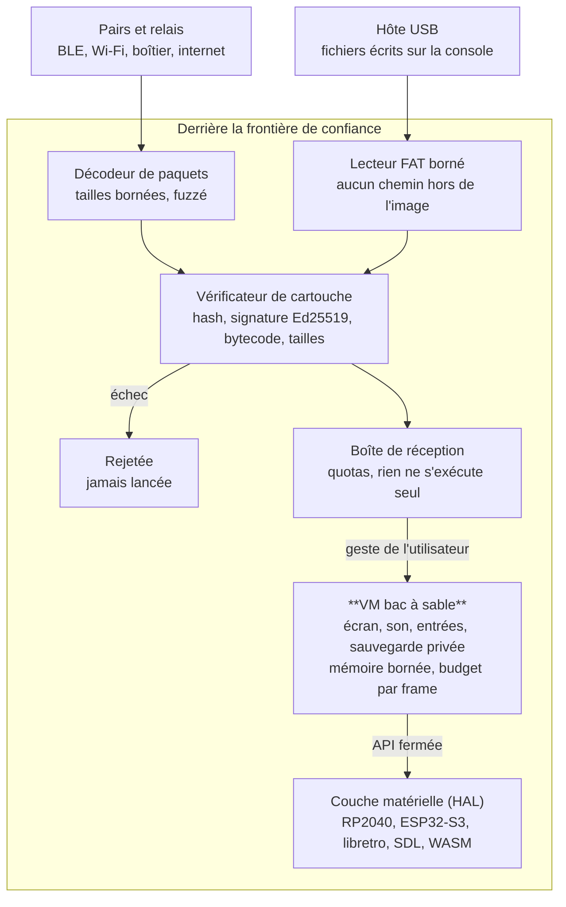

# Bidule — Modèle de menaces et architecture de sécurité

Nov 1, 2026 · @Pierre-Clément

## Objectif et principes directeurs

La pire cartouche possible ne doit pouvoir faire qu'une chose : planter elle-même. Bidule exécute du code écrit par des inconnus, reçu automatiquement de pair à pair, sur des appareils souvent utilisés par des enfants. La sécurité est donc une propriété de l'architecture, pas une couche ajoutée.

Cinq principes guident toutes les décisions de cette section :

1. **Rien à voler.** Bidule ne collecte ni compte, ni donnée personnelle, ni paiement, ni position. Ce qui n'existe pas ne peut pas fuir.
2. **Aucune capacité ambiante.** Une cartouche n'a accès qu'à ce que l'API lui donne explicitement, et l'API ne donne jamais accès au système, au réseau ou aux autres cartouches.
3. **Rien ne s'exécute sans geste humain.** Recevoir n'est pas lancer.
4. **Simplicité vérifiable.** Des formats bêtes, des parseurs courts, un code assez petit pour être audité et fuzzé en entier.
5. **Protéger l'utilisateur, jamais contre l'utilisateur.** Le propriétaire garde le droit de reflasher, modifier et inspecter sa machine.

Contexte : l'audit de code assisté par IA rend la découverte de failles bon marché et massive. On suppose donc que toute faille de corruption mémoire présente dans le code sera trouvée, et on conçoit pour qu'il n'y en ait pas, ou qu'elle ne mène nulle part.

## Périmètre et actifs à protéger

La section couvre toutes les incarnations de Bidule : console matérielle (RP2040, RP2350 ou ESP32-S3), core libretro, application native SDL (PortMaster, PC), version WASM, et boîtiers relais. Elles partagent la même VM et le même protocole, donc les mêmes exigences.

| Actif | Ce qu'on protège | Gravité si compromis |
| --- | --- | --- |
| Intégrité de l'appareil | L'hôte (console, PC, handheld) ne doit jamais exécuter de code natif venu d'une cartouche | Critique |
| Disponibilité | L'appareil reste utilisable : pas de gel, pas de brique, pas de stockage saturé | Haute |
| Sauvegardes et créations locales | Une cartouche ne lit ni n'écrit les données d'une autre | Haute |
| Identité d'auteur | Personne ne peut publier sous la clé d'un autre | Haute |
| Intégrité des cartouches | Une cartouche reçue est exactement celle que l'auteur a signée | Haute |
| Expérience des jeunes utilisateurs | Le contenu reçu reste sous contrôle de l'utilisateur ou d'un parent | Moyenne à haute |
| Vie privée | Bidule ne révèle ni identité civile, ni position, ni habitudes | Moyenne (faible par construction) |

Hors périmètre : la sécurité de l'OS hôte lui-même (Linux d'une Anbernic, navigateur, PC), et la protection contre un attaquant ayant un accès physique prolongé à la console.

## Modèle de menaces

Tout ce qui franchit une frontière de confiance est hostile par défaut : une cartouche, un paquet réseau, un fichier déposé par USB. Le schéma ci-dessous situe ces frontières ; le tableau liste les menaces retenues.

Deux sources hostiles, une seule porte : tout passe par un parseur borné puis par le vérificateur, et seule une action de l'utilisateur fait entrer une cartouche dans la VM.

### Acteurs

- **Auteur malveillant** : publie une cartouche conçue pour s'échapper de la VM, geler l'appareil ou nuire à l'utilisateur.
- **Pair malveillant** : participe au gossip pour inonder, usurper, rejouer ou corrompre des données.
- **Hôte USB malveillant** : un ordinateur qui écrit un système de fichiers piégé sur la console en mode stockage de masse.
- **Chercheur de failles outillé par IA** : fuzz et audite le code source public à grande échelle.
- **Contenu inapproprié** : pas une attaque technique, mais un risque réel pour un jeune public.

### Menaces et réponses

| Menace | Vecteur | Réponse (section) |
| --- | --- | --- |
| Évasion de la VM | Bytecode piégé, accès mémoire hors bornes | VM sans capacités, mémoire bornée, vérificateur (Isolation) |
| Gel de l'appareil | Boucle infinie, allocation excessive | Budget d'instructions par frame, quotas (Isolation) |
| Corruption mémoire de l'hôte | Parseur de cartouche, de paquet ou de FAT | Code memory-safe, formats stricts, fuzzing (Implémentation) |
| Usurpation d'auteur | Cartouche signée d'une fausse identité | Signature Ed25519 obligatoire (Gossip) |
| Altération en transit | Cartouche modifiée par un relais | Adressage par hash (Gossip) |
| Inondation | Milliers de cartouches ou de messages | Quotas par pair, par auteur, en stockage (Gossip) |
| Exécution non voulue | Lancement automatique d'un contenu reçu | Boîte de réception, lancement manuel (Gossip) |
| Firmware piégé | Mise à jour propagée ou falsifiée | Jamais de firmware par gossip, mises à jour signées (Matériel) |
| Contenu inapproprié | Cartouche d'un inconnu | Listes de confiance et de blocage, mode restreint (Modération) |
| Pistage | Identifiants radio ou clés stables | Pas de donnée civile, identifiants radio tournants (Gossip) |

## Isolation des cartouches

La VM est la frontière de sécurité principale : une cartouche n'existe qu'à l'intérieur, et l'intérieur ne contient rien de dangereux.

### Capacités

Une cartouche ne reçoit que :

- l'écran (240×160, couleurs indexées sur 8 bits) ;
- le son ;
- les entrées (boutons, éventuellement souris ou tactile) ;
- un emplacement de sauvegarde privé, de taille fixe, adressé par le hash de la cartouche ;
- ses propres ressources en lecture seule (tuiles, sprites, audio).

Elle ne reçoit jamais : le système de fichiers, le réseau, la radio, l'horloge murale précise, les autres cartouches, les clés de l'utilisateur. Il n'existe ni FFI, ni chargement de code natif, ni `eval` d'une chaîne en bytecode.

Toute capacité future (par exemple un multijoueur local) passe par une API dédiée, bornée, et soumise à une décision explicite dans cette section.

### Mémoire

- La RAM de cartouche a une taille fixe, définie par la spec.
- Chaque accès mémoire est vérifié ou masqué par la VM. Un accès hors bornes arrête la cartouche avec une erreur, jamais l'hôte.
- La pile d'appels et la pile de valeurs ont une profondeur maximale.
- Les ressources en flash (XIP) sont accessibles en lecture seule, par des API qui vérifient les indices.

### Vérification au chargement

Avant toute exécution, le chargeur valide la cartouche entière :

1. en-tête, versions et tailles dans les limites ;
2. chaque opcode connu ;
3. chaque cible de saut à l'intérieur du code et sur une frontière d'instruction ;
4. profondeur de pile cohérente sur chaque chemin ;
5. indices de ressources valides quand ils sont statiques.

Une cartouche refusée n'est pas lancée, et l'utilisateur voit pourquoi.

### Temps et ressources

- **Budget d'instructions par frame.** Une cartouche qui le dépasse saute une frame ; si elle le dépasse durablement, la VM propose de l'arrêter. Le bouton Start de l'hôte, qui ouvre le menu système, reste toujours actif : l'hôte le traite avant que la cartouche ne voie la moindre entrée, et la cartouche ne peut ni le lire, ni masquer le menu, ni en imiter les entrées (SEC-9 de la spécification technique). Les entrées de menu que des cartouches pourront ajouter plus tard sont réservées et affichées par le système, après un séparateur, dans un style distinct.
- **Pas d'allocation dynamique illimitée.** Toute structure grandissante a un plafond.
- **Le son** est généré dans des tampons de taille fixe : une cartouche ne peut pas saturer le DSP de l'hôte.

## Implémentation

Le noyau (VM, chargeur, formats, protocole) est écrit dans un langage memory-safe, ou à défaut sous un régime de fuzzing continu. C'est la réponse directe aux failles trouvées en masse par l'IA, qui sont majoritairement des corruptions mémoire.

### Langage

- **Décision : Rust `no_std`** pour la VM et le compilateur. Une seule base de code compile pour RP2040, RP2350, ESP32-S3, WASM, et peut produire un core libretro et une application SDL. Le `unsafe` est confiné à la couche d'abstraction matérielle et listé explicitement.
- Le travail existant en C (TinyUSB, FAT12) reste derrière la couche d'abstraction matérielle ; le noyau, lui, n'est pas en C.
- Le noyau ne connaît pas la plateforme : il passe par une couche d'abstraction matérielle étroite (écran, son, entrées, stockage, transport).

### Formats

Les formats sont conçus pour être parsés sans surprise :

- en-têtes à champs de taille fixe, longueurs préfixées, tailles maximales strictes pour chaque champ ;
- un seul encodage canonique par donnée (indispensable pour le hash et la signature) ;
- pas de compression généraliste dans le format de transport ; si une compression est nécessaire, un algorithme simple à taille de sortie déclarée et vérifiée (la section source de la cartouche n'est pas compressée) ;
- le parseur transforme les octets en types validés dès l'entrée, et le reste du code ne manipule que ces types.

### Vérification continue

- **Fuzzing** permanent (cargo-fuzz ou libFuzzer, AFL++) de trois cibles : le chargeur de cartouches, le décodeur de paquets du protocole, le lecteur FAT du mode USB.
- **Tests de propriétés** sur la VM : aucun programme valide ou invalide ne fait accéder l'interpréteur hors de la mémoire de la cartouche.
- **Audit assisté par IA** du dépôt avant chaque version : se servir des mêmes outils que les attaquants, avant eux.
- **Politique de divulgation** publique (fichier `SECURITY.md`), avec un contact et un délai de correction annoncé.

## Identité, intégrité et protocole d'échange

L'intégrité et l'authenticité reposent sur la cryptographie, jamais sur un serveur : une cartouche est identifiée par son hash et signée par la clé de son auteur, quel que soit le chemin qu'elle a pris.

### Identité

- Une identité d'auteur est une paire de clés Ed25519, générée localement. Aucune inscription, aucun annuaire central.
- Le nom affiché est une simple étiquette choisie par l'auteur, sans valeur d'authentification. Deux auteurs peuvent porter le même nom ; l'interface montre aussi une empreinte courte de la clé.
- La clé privée ne quitte jamais l'appareil sauf export explicite par l'utilisateur (sauvegarde, migration).
- Bibliothèque candidate pour microcontrôleur : Monocypher, ou ses équivalents Rust.

### Cartouches

- L'identifiant d'une cartouche est le hash (BLAKE2b ou SHA-256) de son encodage canonique.
- Chaque cartouche porte la signature de son auteur sur ce hash. Une cartouche non signée ou mal signée est rejetée à la réception.
- Une nouvelle version d'une cartouche est une nouvelle cartouche, qui référence la précédente.

### Deux niveaux d'échange

1. **Carte de visite** (quelques centaines d'octets) : titre, auteur, empreinte de clé, vignette, hash, taille. C'est ce qui s'échange passivement, en proximité.
2. **Cartouche complète** : récupérée seulement si l'utilisateur l'a marquée, au prochain relais, rassemblement ou connexion.

### Règles du protocole

- **Rien ne s'exécute automatiquement.** Les contenus reçus arrivent dans une boîte de réception ; le lancement est toujours un geste de l'utilisateur.
- **Quotas** par pair, par auteur et en stockage total. Au-delà, les éléments les plus anciens non marqués sont évincés.
- **Limites de taille** vérifiées avant toute réception de données, d'après l'en-tête, puis contrôlées pendant le transfert.
- **Isolation** : le code réseau et le parseur de paquets ne partagent aucune mémoire avec la VM. Ils ne livrent à la VM que des cartouches vérifiées.
- **Vie privée** : identifiants radio (BLE) tournants, aucune clé d'auteur diffusée dans les annonces de proximité tant que l'utilisateur n'a rien publié.
- **Même protocole, plusieurs transports** : BLE, Wi-Fi local (diffusion UDP ou mDNS), boîtier relais, clé USB, relais internet. Les règles ci-dessus s'appliquent identiquement à tous.

## Confiance et modération décentralisée

Sans serveur central, la modération est locale et composable : chaque appareil décide de ce qu'il accepte, en s'appuyant éventuellement sur des personnes de confiance.

- **Listes de blocage locales** par clé d'auteur. Un auteur bloqué n'est plus reçu, et ses contenus déjà présents sont masqués.
- **Listes partagées** : un utilisateur peut s'abonner aux listes de blocage ou de recommandation d'une autre clé (un club, une école, un ami). Ces listes sont elles-mêmes des objets signés qui circulent par le même protocole, sur le modèle des « labelers » de Bluesky.
- **Mode restreint**, activable et verrouillable par un code parent : ne recevoir que des auteurs suivis, ou suivis par ceux qu'on suit.
- **Mode par défaut** : à trancher (voir questions ouvertes). Proposition : réception des cartes de visite de tout le monde, mais téléchargement des cartouches complètes uniquement sur action de l'utilisateur.
- **Signalement** : produire un signalement revient à ajouter la clé ou le hash à sa propre liste publique. Ceux qui suivent cette liste en profitent.

Limite assumée : aucune autorité ne peut retirer une cartouche du réseau. On ne peut que cesser de la propager et la masquer chez soi.

## Matériel, firmware et mises à jour

La console est ouverte : la sécurité protège son propriétaire, elle ne l'enferme pas. Le Secure Boot verrouillé est un anti-objectif.

### Firmware

- Le bootloader en ROM du RP2040/RP2350 (mode BOOTSEL) rend la console impossible à bricker par logiciel. Cette propriété est à préserver sur toute cible ; sur ESP32-S3, le mode de téléchargement ROM doit rester accessible.
- Les firmwares officiels sont signés. La console vérifie la signature par défaut et signale clairement un firmware non officiel, sans l'interdire.
- Le propriétaire peut flasher n'importe quel firmware par un geste physique explicite (bouton au démarrage).
- **Aucun firmware ne circule par gossip.** Le protocole ne transporte que des cartouches, des cartes de visite et des listes signées.

### Mode stockage de masse USB

- Le contenu écrit par l'ordinateur est considéré comme hostile : le lecteur FAT est fuzzé et borné, et le noyau ne suit aucun chemin hors de l'image prévue.
- Une cartouche déposée par USB rejoint la boîte de réception, comme une cartouche reçue par radio. Elle passe la même vérification et n'est jamais lancée automatiquement.

### Plateformes hôtes (libretro, SDL, WASM)

- Les mêmes règles s'appliquent : le core ou l'application n'expose à la cartouche aucune capacité de l'hôte.
- L'application native n'écrit que dans son propre dossier de données.

## Exigences récapitulatives et questions ouvertes

### Exigences

| ID | Exigence |
| --- | --- |
| SEC-01 | Une cartouche n'accède qu'à l'écran, au son, aux entrées, à sa sauvegarde et à ses ressources. |
| SEC-02 | Tout accès mémoire d'une cartouche est borné ; un dépassement n'arrête que la cartouche. |
| SEC-03 | Toute cartouche est vérifiée intégralement avant sa première exécution. |
| SEC-04 | Un budget d'instructions par frame empêche toute cartouche de geler l'hôte. |
| SEC-05 | Le noyau est memory-safe, ou fuzzé en continu sur tous ses parseurs. |
| SEC-06 | Chaque format a un encodage canonique unique et des tailles maximales. |
| SEC-07 | Une cartouche est identifiée par son hash et signée en Ed25519 par son auteur. |
| SEC-08 | Aucun contenu reçu, par quelque transport que ce soit, n'est exécuté automatiquement. |
| SEC-09 | Le protocole applique des quotas par pair, par auteur et en stockage. |
| SEC-10 | Aucun firmware ne circule par le protocole d'échange. |
| SEC-11 | Le propriétaire peut toujours reflasher sa console par un geste physique. |
| SEC-12 | Bidule ne collecte aucune donnée personnelle ni position. |

### Questions ouvertes

- [x] Rust `no_std` ou C pour le noyau ? Décidé : Rust `no_std` (voir Implémentation).
- [ ] Mode de réception par défaut : ouvert (cartes de visite de tous) ou restreint (auteurs suivis) ?
- [ ] Les sauvegardes peuvent-elles être partagées entre versions successives d'une même cartouche ?
- [ ] Faut-il une révocation de clé (clé perdue ou volée), et sous quelle forme sans autorité centrale ?
- [ ] Quelle API minimale pour un futur multijoueur local, sans ouvrir le réseau à la VM ?
